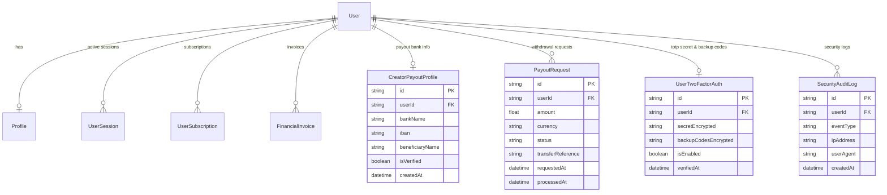
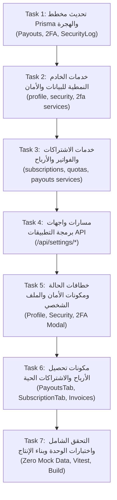

# تصميم نظام إعدادات الحساب والأمان والاشتراك وتحصيل الأرباح
## (Account, Security, Subscription & Payouts Architecture Blueprint)

* **المؤلف (Author):** Ammar
* **الحالة (Status):** مسودة للمراجعة (Draft for Review)
* **التاريخ (Date):** 2026-11-16
* **المرجع المعياري:** [`skills/feature-modular-structure/SKILL.md`](file:///home/ammar/AN%20LINKS/skills/feature-modular-structure/SKILL.md) و [`plugins/egm`](file:///home/ammar/.gemini/config/plugins/egm)
* **النطاق (Scope):** `src/features/settings/*`, `src/app/api/settings/*`, `prisma/schema.prisma`

---

## 1. المشكلة وسياق العمل (The Problem & Context)

تحتوي صفحة الإعدادات الحالية (`/dashboard/settings`) على تبويبات متعددة، إلا أن أجزاء واسعة منها تعتمد على بيانات واجهة ساكنة (Mock Data) أو تفتقر إلى التكامل الخلفي الحقيقي، وتحديداً:
1. **الاشتراك والفواتير (Subscription & Billing):** تبويب الاشتراك يعرض بطاقة ثابتة ومصطنعة ("Al Rajhi mada Debit" و "FAISAL A ALMANSOUR") ولا يعكس جدول الاشتراكات الفعلي `UserSubscription` أو حدود الباقات `PlanQuota` أو سجل الفواتير `FinancialInvoice`.
2. **بوابات تحصيل أرباح صناع المحتوى (Creator Payouts):** تبويب التحصيل يعرض رصيداً ساكناً وبطاقات غير مربوطة بنظام سحب حقيقي أو تحقق آلي من الآيبان البنكي السعودي (IBAN) أو سجل طلبات السحب.
3. **الأمان المتقدم والمصادقة (Advanced Security & 2FA):** بطاقة المصادقة الثنائية (2FA) هي مجرد واجهة عرض لا تولد مفاتيح TOTP أو رموز QR أو رموز استرداد احتياطية، مع الحاجة لربط تغيير كلمة المرور بتشفير bcrypt وسجل النشاط الأمني.
4. **الامتثال للهيكلية النمطية (`feature-modular-structure`):** تفكيك مكونات الإعدادات والخدمات والخطافات بحيث لا يتجاوز أي ملف 250 سطراً (المستهدف <150 سطراً ودوال <40 سطراً).

---

## 2. الهيكلية ونموذج البيانات (Architecture & Data Model)

لتشغيل النظام ببيانات حقيقية 100% دون أي معلومات وهمية، يتم توسيع وتحديث قاعدة بيانات Prisma:

### ملخص الحقول والجداول الجديدة:
1. **`CreatorPayoutProfile`:** حساب الآيبان والبنك المعتمد لصانع المحتوى لتحويل أرباح مبيعات الروابط والمنتجات.
2. **`PayoutRequest`:** سجل طلبات السحب والحالات (`PENDING`, `APPROVED`, `REJECTED`, `TRANSFERRED`).
3. **`UserTwoFactorAuth`:** تشفير مفتاح الـ TOTP المشترك (AES-256-GCM) والرموز الاحتياطية الثمانية المشفرة.
4. **`SecurityAuditLog`:** توثيق أحداث الأمان (تسجيل الدخول، تغيير كلمة المرور، تفعيل 2FA، إنهاء جلسة).

---

## 3. القرارات المعمارية الرئيسية (Key Architectural Decisions)

### القرار 1: آلية المصادقة الثنائية (2FA Implementation Mechanism)
* **الخيار أ (المعتمد):** المصادقة عبر تطبيقات الرموز الزمنية (TOTP - Time-based One-Time Password) المتوافقة مع معيار RFC 6238 (مثل Google Authenticator, 1Password, Apple Passwords).
  - *المزايا:* مجانية بالكامل، لا تعتمد على بوابات SMS المكلفة وغير الموثوقة، وتوفر أماناً تشفيرياً عالياً مع رموز استرداد احتياطية (8 Backup Codes).
  - *الآلية:* توليد `otpauth://` URI، تصيير QR Code في المتصفح، والتحقق من إدخال رمز صحيح 6 أرقام قبل اعتماد التفعيل في قاعدة البيانات.

### القرار 2: معمارية بوابات تحصيل أرباح صناع المحتوى (Payouts Architecture)
* **التحقق من الآيبان (IBAN Validation):** تطبيق الخوارزمية القياسية للآيبان السعودي (MOD 97-10 check مع بادئة `SA` و 24 حرفاً ورقم بنكي معتمد مثل الراجحي، الأهلي، الإنماء، الرياض).
* **إدارة الرصيد والسحب:**
  - احتساب الرصيد الحقيقي من مبيعات الروابط مطروحاً منها العمولات والسحوبات السابقة.
  - إمكانية تقديم طلب سحب بحد أدنى (مثلاً 100 ر.س)، يدخل في قائمة المراجعة الآلية أو اليدوية لإدارة النظام.

### القرار 3: الاشتراك الحي واستهلاك الحصص (Live Subscriptions & Quota Metering)
* قراءة بيانات اشتراك المستخدم مباشرة من `UserSubscription` المربوط بـ `SubscriptionPlan`.
* حساب الاستهلاك الفعلي للمميزات:
  - عدد الروابط الحالية vs `maxLinks` في الخطة.
  - النطاق المخصص vs `allowCustomDomain`.
  - المظهر المتقدم vs `allowAdvancedThemes`.
* عرض سجل الفواتير الحقيقي `FinancialInvoice` وتوليد فوري لطباعة وتحميل الفاتورة الضريبية بصيغة متوافقة مع هيئة الزكاة والضريبة والجمارك (ZATCA compliant 15% VAT).

### القرار 4: الامتثال الصارم للهيكلية النمطية (`feature-modular-structure`)
* تفكيك التبويبات الكبيرة (مثل `SecurityTab.tsx` البالغ 219 سطراً) إلى مكونات ذرية:
  - `SecurityPasswordForm.tsx` (<80 سطر).
  - `SecurityTwoFactorCard.tsx` (<90 سطر).
  - `SecuritySessionsList.tsx` (<100 سطر).
  - `SecurityAuditLogModal.tsx` (<90 سطر).
* إنشاء خدمات الخادم النمطية تحت `src/features/settings/server/`:
  - `profile.service.ts` (<100 سطر).
  - `payouts.service.ts` (<120 سطر).
  - `subscription.service.ts` (<120 سطر).
  - `security.service.ts` (<130 سطر).
  - `two-factor.service.ts` (<110 سطر).

---

## 4. خارطة طريق المهام التنفيذية (Tasks 1 - 7)

* **Task 1 (Prisma & DB):** إضافة نماذج `CreatorPayoutProfile`, `PayoutRequest`, `UserTwoFactorAuth`, `SecurityAuditLog` إلى `prisma/schema.prisma` وإنشاء عميل Prisma والترحيل.
* **Task 2 (Server Core & 2FA):** إنشاء خدمات الأمان والمصادقة الثنائية `security.service.ts` و `two-factor.service.ts` و `profile.service.ts` مع التشفير الآمن.
* **Task 3 (Server Financials & Quotas):** إنشاء خدمات تحصيل الأرباح `payouts.service.ts` وربط الاشتراكات والاستهلاك الحقيقي `subscription.service.ts`.
* **Task 4 (API Route Handlers):** إنشاء مسارات `/api/settings/profile`, `/api/settings/security/2fa`, `/api/settings/security/password`, `/api/settings/payouts`, `/api/settings/subscription`.
* **Task 5 (Profile & Security UI):** تفكيك وتطوير `ProfileTab.tsx` و `SecurityTab.tsx` ونافذة إعداد TOTP مع رمز QR واختبارات الجلسات.
* **Task 6 (Payouts & Subscription UI):** تفكيك وتطوير `PayoutsTab.tsx` و `SubscriptionTab.tsx` لعرض بيانات حقيقية 100% مع قائمة الفواتير وتغيير الخطة وإدارة الآيبان.
* **Task 7 (Verification & Quality Gates):** كتابة حزمة اختبارات شاملة لجميع المسارات والخدمات، التأكد من أن جميع الملفات $\le 250$ سطراً، واجتياز `npm run test` و `npm run build`.

