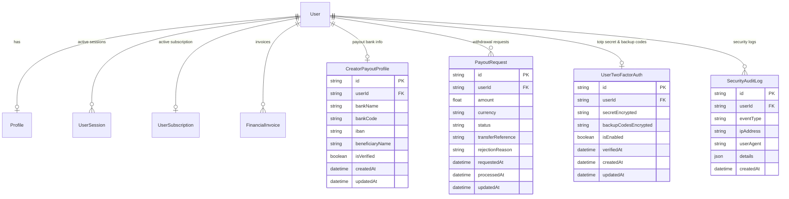
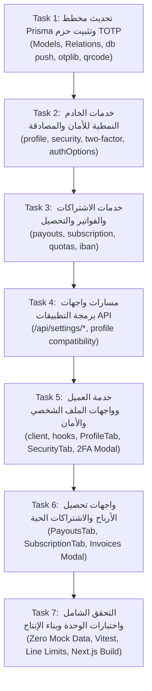

# تصميم نظام إعدادات الحساب والأمان والاشتراك وتحصيل الأرباح
## (Account, Security, Subscription & Payouts Architecture Blueprint)

* **المؤلف (Author):** Ammar
* **الحالة (Status):** Approved & Aligned with Goldfish Audits (Ready for SDD Execution)
* **التاريخ (Date):** 2026-11-16
* **المرجع المعياري:** [`skills/feature-modular-structure/SKILL.md`](file:///home/ammar/AN%20LINKS/skills/feature-modular-structure/SKILL.md) و [`plugins/egm`](file:///home/ammar/.gemini/config/plugins/egm)
* **تقرير التدقيق والتوليف:** [`docs/designs/implementation_readiness_report_settings.md`](file:///home/ammar/AN%20LINKS/docs/designs/implementation_readiness_report_settings.md)
* **النطاق (Scope):** `src/features/settings/*`, `src/app/api/settings/*`, `prisma/schema.prisma`

---

## 1. المشكلة وسياق العمل (The Problem & Context)

تحتوي صفحة الإعدادات الحالية (`/dashboard/settings`) على تبويبات متعددة، إلا أن أجزاء واسعة منها تعتمد على بيانات واجهة ساكنة (Mock Data) أو تفتقر إلى التكامل الخلفي الحقيقي، وتحديداً:
1. **الاشتراك والفواتير (Subscription & Billing):** يعرض تبويب الاشتراك بطاقة ثابتة ومصطنعة ("Al Rajhi mada Debit" و "FAISAL A ALMANSOUR") ولا يعكس جدول الاشتراكات الفعلي `UserSubscription`، أو حدود الباقات `PlanQuota`، أو سجل الفواتير `FinancialInvoice`.
2. **تحصيل أرباح صناع المحتوى (Creator Payouts):** يعرض تبويب التحصيل رصيداً ساكناً وبطاقات غير مربوطة بنظام سحب حقيقي أو تحقق آلي من الآيبان البنكي السعودي (IBAN) أو سجل طلبات السحب.
3. **الأمان المتقدم والمصادقة (Advanced Security & 2FA):** بطاقة المصادقة الثنائية (2FA) هي مجرد واجهة عرض لا تولد مفاتيح TOTP أو رموز QR أو رموز استرداد احتياطية، مع الحاجة لربط تغيير كلمة المرور بتشفير bcrypt وسجل النشاط الأمني.
4. **الامتثال للهيكلية النمطية (`feature-modular-structure`):** تفكيك مكونات الإعدادات والخدمات والخطافات بحيث لا يتجاوز أي ملف 250 سطراً (المستهدف <150 سطراً ودوال <40 سطراً) وعزل ملفات البرميل (Barrel Files) لمنع تسريب كود الخادم إلى حزم العميل.

---

## 2. الهيكلية ونموذج البيانات (Architecture & Data Model)

### مخطط العلاقات (Entity-Relationship Diagram)



### تعريف مخطط Prisma المحدث (Prisma Schema DDL)

#### تحديث نموذج `User`:
```prisma
model User {
  id                String               @id @default(cuid())
  email             String               @unique
  passwordHash      String?
  username          String               @unique
  role              String               @default("USER")
  emailVerified     DateTime?
  isSuspended       Boolean              @default(false)
  createdAt         DateTime             @default(now())
  updatedAt         DateTime             @updatedAt
  profile           Profile?
  links             Link[]
  socials           SocialLink[]
  sessions          UserSession[]
  subscriptions     UserSubscription[]
  invoices          FinancialInvoice[]
  auditLogs         FinancialAuditLog[]
  payoutProfile     CreatorPayoutProfile?
  payoutRequests    PayoutRequest[]
  twoFactorAuth     UserTwoFactorAuth?
  securityAuditLogs SecurityAuditLog[]
}
```

#### النماذج الأربعة الجديدة:
```prisma
model CreatorPayoutProfile {
  id              String   @id @default(cuid())
  userId          String   @unique
  user            User     @relation(fields: [userId], references: [id], onDelete: Cascade)
  bankName        String
  bankCode        String   // e.g. "80" (Al Rajhi), "10" (SNB), "50" (Alinma)
  iban            String   // Full validated Saudi IBAN (SA...)
  beneficiaryName String
  isVerified      Boolean  @default(true)
  createdAt       DateTime @default(now())
  updatedAt       DateTime @updatedAt
}

model PayoutRequest {
  id                String    @id @default(cuid())
  userId            String
  user              User      @relation(fields: [userId], references: [id], onDelete: Cascade)
  amount            Float
  currency          String    @default("SAR")
  status            String    @default("PENDING") // PENDING, APPROVED, TRANSFERRED, REJECTED
  transferReference String?
  rejectionReason   String?
  requestedAt       DateTime  @default(now())
  processedAt       DateTime?
  updatedAt         DateTime  @updatedAt

  @@index([userId, status])
}

model UserTwoFactorAuth {
  id                   String    @id @default(cuid())
  userId               String    @unique
  user                 User      @relation(fields: [userId], references: [id], onDelete: Cascade)
  secretEncrypted      String    // AES-256-GCM encrypted base32 secret
  backupCodesEncrypted String    // AES-256-GCM encrypted JSON array of { codeHash, used, usedAt }
  isEnabled            Boolean   @default(false)
  verifiedAt           DateTime?
  createdAt            DateTime  @default(now())
  updatedAt            DateTime  @updatedAt
}

model SecurityAuditLog {
  id        String   @id @default(cuid())
  userId    String
  user      User     @relation(fields: [userId], references: [id], onDelete: Cascade)
  eventType String   // LOGIN, PASSWORD_CHANGE, 2FA_ENABLE, 2FA_DISABLE, SESSION_REVOKE, IBAN_UPDATE
  ipAddress String?
  userAgent String?
  details   Json?
  createdAt DateTime @default(now())

  @@index([userId, createdAt])
}
```

---

## 3. القرارات المعمارية الرئيسية (Key Architectural Decisions)

### القرار 1: آلية المصادقة الثنائية وتكامل دورة تسجيل الدخول (2FA & Login Challenge)
1. **الاعتماد على الحزم الرسمية:**
   * تثبيت `otplib` و `qrcode` مع حزمة الأنواع `@types/qrcode`.
2. **دورة حياة التفعيل (Enrollment State Machine):**
   * عند طلب الإعداد: توليد سر TOTP عشوائي ومصفوفة من 8 رموز استرداد احتياطية بصيغة `XXXX-XXXX`.
   * تخزين السجل في `UserTwoFactorAuth` بحيث تكون `isEnabled = false` مشفرة بـ `PAYMENT_ENCRYPTION_KEY` (AES-256-GCM).
   * إرجاع رمز QR DataURL و URI بصيغة `otpauth://totp/AN%20LINKS:{username}?secret={secret}&issuer=AN%20LINKS`.
   * يتم تفعيل الـ 2FA (`isEnabled = true`, `verifiedAt = now()`) فقط بعد أن يزود المستخدم رمزاً سداسياً صالحاً ويتم التحقق منه بنجاح.
3. **تحمل انحراف الساعة (Clock Skew Tolerance) والحد من المحاولات:**
   * ضبط نافذة التحقق بنافذة خطوة واحدة ($\pm 1$ step أي 90 ثانية إجمالاً) لاستيعاب أي انحراف بسيط في توقيت هاتف العميل.
   * تحديد حد أقصى للمحاولات الفاشلة (Max 5 attempts per 15 mins) لمنع هجمات التخمين.
4. **تكامل دورة تسجيل الدخول مع NextAuth (`authOptions`):**
   * في `CredentialsProvider.authorize`: إذا كان المستخدم يملك `twoFactorAuth?.isEnabled === true`، يتم فحص حقل `totpCode` الوارد في بيانات الاعتماد.
   * إذا لم يُرسل الرمز، يتم إرجاع خطأ رمزي `"2FA_REQUIRED"` ليوجه واجهة تسجيل الدخول لعرض حقل إدخال الرمز السداسي أو الرمز الاحتياطي.
   * يتم دعم تسجيل الدخول بالرمز الاحتياطي لمرة واحدة وإبطاله ذرياً (`used: true`, `usedAt: now()`).

### القرار 2: التحقق الصارم من الآيبان السعودي وبنوك ساما (Saudi IBAN & SAMA Bank Routing)
1. **خوارزمية التحقق القياسية ISO 7064 MOD 97-10:**
   * تنظيف الآيبان وتحويله للأحرف الكبيرة وإزالة المسافات.
   * التحقق من الطول (24 خانة) والبادئة `SA`.
   * إعادة ترتيب الخانات: نقل أول 4 خانات (`SA` + رقمي التحقق) إلى النهاية.
   * تحويل الأحرف إلى أرقام (`A` = 10, `S` = 28)، ثم فحص قابلية القسمة: `BigInt(numericString) % 97n === 1n`.
2. **جدول رموز البنوك السعودية المعترف بها من البنك المركزي السعودي (SAMA):**
   * `80`: مصرف الراجحي (Al Rajhi Bank)
   * `10`: البنك الأهلي السعودي (SNB)
   * `50`: بنك الإنماء (Alinma Bank)
   * `20`: بنك الرياض (Riyad Bank)
   * `15`: بنك البلاد (Bank Albilad)
   * `05`: البنك السعودي البريطاني (SAB)
   * `65`: بنك الجزيرة (Bank AlJazira)
   * `45`: البنك السعودي للاستثمار (SAIB)
   * `55`: بنك الخليج الدولي (GIB)

### القرار 3: إدارة اشتراكات حية واستهلاك الحصص والفاتورة الضريبية المبسطة
1. **الاشتراك الحي والرجوع إلى الباقة المجانية (Free Tier Fallback):**
   * عند استعلام `/api/settings/subscription`: إذا لم يملك المستخدم سجلاً في `UserSubscription`، يتم جلب باقة `free` الافتراضية مع حصصها وإرجاع حالة نشطة `ACTIVE`.
2. **احتساب الحصص الحقيقية:**
   * الروابط: عدد روابط المستخدم الفعلية (`prisma.link.count`) مقابل `maxLinks` في الخطة.
   * المنصات الاجتماعية: عدد الروابط الاجتماعية مقابل الحصة.
   * الميزات المتقدمة: التحقق من `allowCustomDomain` و `allowAdvancedThemes`.
3. **إلغاء الاشتراك (Cancellation Semantics):**
   * عند الإلغاء: تعيين `cancelAtPeriodEnd = true` ويبقى الحساب نشطاً حتى نهاية الفترة `currentPeriodEnd`.
4. **الفاتورة الضريبية المبسطة (Simplified Tax Invoice):**
   * جلب فواتير المستخدم الحقيقية من `FinancialInvoice`.
   * توفير نافذة عرض وطباعة نظيفة بتنسيق CSS Print مخصص مع تطبيق ضريبة القيمة المضافة 15% وتفاصيل المنشأة ورقم التسجيل الضريبي.

### القرار 4: عزل طبقات الخادم والعميل والامتثال للهيكلية النمطية
1. **عزل ملف البرميل (Barrel File Isolation):**
   * `src/features/settings/index.ts` يُصدر فقط الكود المشترك والعميل: الأنواع (`types/settings.types`)، المدققات العامة (`validators/settings.validator`)، المكونات، والخطافات.
   * خدمات الخادم (`src/features/settings/server/*`) لا تُصدر عبر `index.ts` نهائياً لمنع Next.js من تضمين `prisma` و `crypto` و `bcryptjs` في حزم الواجهة الأمامية.
2. **خدمة عميل موحدة وخطافات React مخصصة:**
   * `src/features/settings/services/settings.client.ts` لجميع استدعاءات `fetch`.
   * الخطافات: `useSettingsProfile`, `useSettingsSecurity`, `useSettingsPayouts`, `useSettingsSubscription`.
3. **تفكيك المكونات إلى أقل من 150 سطراً:**
   * `ProfileTab.tsx` و `AvatarUploadCard.tsx`.
   * `SecurityTab.tsx`, `SecurityPasswordForm.tsx`, `SecurityTwoFactorCard.tsx`, `SecuritySessionsList.tsx`, `TwoFactorModal.tsx`.
   * `PayoutsTab.tsx`, `PayoutBalanceCard.tsx`, `PayoutIbanForm.tsx`, `PayoutWithdrawModal.tsx`, `PayoutHistoryTable.tsx`.
   * `SubscriptionTab.tsx`, `SubscriptionActivePlanCard.tsx`, `SubscriptionQuotasGrid.tsx`, `SubscriptionInvoicesTable.tsx`, `InvoicePrintModal.tsx`.

---

## 4. خارطة طريق المهام التنفيذية (Tasks 1 - 7)



* **Task 1 (Prisma & Packages):** تثبيت `otplib` و `qrcode` مع `@types/qrcode`. إضافة النماذج الأربعة وتحديث نموذج `User` في `prisma/schema.prisma`، وتشغيل `npx prisma validate && npx prisma db push`.
* **Task 2 (Server Core, Security & 2FA):** كتابة `src/features/settings/server/profile.service.ts`، `security.service.ts`، و `two-factor.service.ts`. تحديث `authOptions` لدعم التحقق الثنائي.
* **Task 3 (Server Financials, Payouts & Quotas):** كتابة `src/features/settings/server/payouts.service.ts` و `subscription.service.ts` مع فحص الآيبان MOD 97-10 والرجوع للباقة المجانية.
* **Task 4 (API Route Handlers):** إنشاء مسارات `/api/settings/profile`، `/api/settings/security/password`، `/api/settings/security/2fa`، `/api/settings/payouts`، و `/api/settings/subscription` مع الحفاظ على التوافق الخلفي لـ `/api/profile`.
* **Task 5 (Client Service, Profile & Security UI):** إنشاء `settings.client.ts` وخطافات `useSettingsProfile` و `useSettingsSecurity`. تفكيك وتطوير `ProfileTab` و `SecurityTab` ومكونات الـ 2FA والجلسات.
* **Task 6 (Payouts & Subscription UI):** إنشاء خطافات `useSettingsPayouts` و `useSettingsSubscription`. تفكيك وتطوير `PayoutsTab` و `SubscriptionTab` وعرض الفواتير الحقيقية وطباعة الفاتورة المبسطة.
* **Task 7 (Verification & Quality Gates):** كتابة اختبارات وحدة وتكامل، التأكد من أن جميع الملفات $\le 250$ سطراً (أقل من 150 سطراً)، واجتياز `npm run test` و `npm run build` بنجاح 100%.
