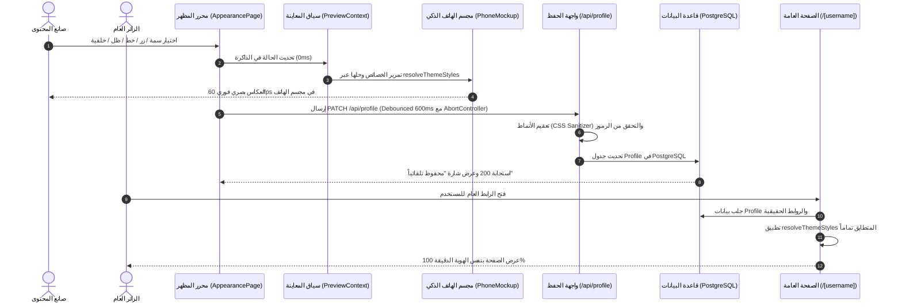

# تصميم نظام تخصيص المظهر والهوية والمعاينة الحية في مجسم الهاتف (Appearance & Visual Identity System)

* **المؤلف (Author):** Ammar
* **الحالة (Status):** Approved (Post-Review Synthesized)
* **التاريخ (Date):** 2026-11-16
* **النطاق (Scope):** `prisma/schema.prisma`, `src/features/appearance/*`, `src/features/dashboard/*`, `src/shared/ui/phone/*`, `src/features/bio/*`, `src/app/(dashboard)/dashboard/appearance/*`, `src/app/api/profile/*`, `src/app/layout.tsx`, `tailwind.config.ts`

---

## 1. المشكلة وسياق العمل (The Problem & Context)

صفحة الملف التعريفي والروابط الحيوية (Bio Link Page) هي الواجهة البصرية الأساسية لكل صانع محتوى وتاجر ومؤثر. يعتمد المستخدمون على تخصيص مظهر صفحتهم ليعكس هويتهم بدقة واحترافية. إلا أن منظومة المظهر الحالية في AN LINKS تعاني من ثغرات بنيوية تجعل تجربة التخصيص جزئية ومفصولة عن المعاينة:

1. **انفصال مجسم الهاتف الذكي عن خيارات المظهر (Decoupled Phone Mockup):**
   - مجسم الهاتف في `PhoneScreenContent.tsx` يتجاهل خصائص المظهر؛ حيث لا يطبق `themeKey`، ولا يغير خلفية الشاشة وفق السمة، ولا يعكس نمط الأزرار (`buttonStyle` كـ filled أو glass أو outline أو soft)، ولا يطبق الخط المختار (`font`)، بل يقتصر على عرض مظهر ثابت.
   - يعتمد المكون حالياً على بيانات وهمية (`DEFAULT_LINKS`, `DEFAULT_SOCIALS`, Unsplash URLs) مما ينتهك معيار "Zero Fake Data".
   - المستخدم يغير الألوان والسمات والخطوط في لوحة التحكم، لكن مجسم الهاتف الذكي يظل ثابتاً ولا يعكس التغييرات إطلاقاً!
2. **تباين المظهر بين لوحة التحكم والصفحة العامة (Preview-to-Production Discrepancy):**
   - الأنماط المطبقة في لوحة المظهر لا تتطابق بشكل تام مع ما يتم تصييره في صفحة الـ Bio العامة (`/[username]`) بسبب غياب محرك نمذجة موحد (`theme-resolver`).
3. **محدودية خيارات الهوية البصرية وخيارات الأزرار:**
   - عدم وجود خيارات للخلفيات المخصصة (لون مسمط أو تدرجات لونية آمنة)، وعدم دعم ظلال الأزرار (`buttonShadow`)، وعدم التحكم بموضع شبكات التواصل (`socialPosition`: أعلى/أسفل الروابط).
4. **نقص دعم الخطوط العربية وتكوين Tailwind:**
   - ملف `layout.tsx` يحمل خطين فقط عبر وسوم `<link>`، وتغيب خطوط Tajawal و Almarai و Readex Pro، وتفتقر `tailwind.config.ts` لفئات الخطوط المفقودة.

---

## 2. الأهداف وغير الأهداف (Goals & Non-Goals)

### الأهداف (Goals)
- **انعكاس بصري فوري بنسبة 100% (Real-time Live Reflection):** أي تعديل في لوحة التحكم (السمة، الألوان، نمط الأزرار، استدارة الحواف، الخط، الظلال، موضع الأيقونات) ينعكس فورياً (<16ms / 60fps) داخل مجسم الهاتف الذكي في شاشة التخصيص.
- **تطابق بصري تام بين المحرر والصفحة العامة:** اعتماد محرك دوال نقية موحد `resolveThemeStyles` يضمن أن ما يراه المستخدم في مجسم الهاتف هو تماماً وبنسبة 100% ما يراه الزائر عند زيارة `/[username]`.
- **معيار حظر البيانات الوهمية (Strict Zero-Mock Data):** مجسم الهاتف يعرض فقط البيانات الحقيقية للمستخدم، مع عرض الحرف الأول (Avatar Initial) والحالة الفارغة النظيفة المتطابقة مع `BioPageContent.tsx`.
- **مكتبة سمات عربية ثرية (12 سمة متكاملة):** دعم 12 سمة جاهزة تشمل الوضع الداكن والفاتح والنيون والباستيل بأسلوب Material 3 / Bento.
- **دعم متكامل لـ 5 خطوط عربية رائدة:** تحميل (Cairo, Tajawal, IBM Plex Sans Arabic, Almarai, Readex Pro) عبر `next/font/google` مع متغيرات CSS.
- **حفظ متين وآمن:** حفظ تلقائي هادئ عبر `PATCH /api/profile` (Debounced 600ms) مع زر حفظ يدوي فوري، وحماية صارمة من حقن CSS (CSS Sanitizer).

### غير الأهداف (Non-Goals)
- محرر مرئي عشوائي بالسحب والإفلات لعناصر HTML حرة (WYSIWYG layout builder).
- إنشاء متجر لبيع السمات أو تحصيل رسوم على الخطوط.

---

## 3. القرارات المعمارية المعتمدة (Architectural Decisions)

### القرار 1: تحميل الخطوط العربية عبر Next.js Google Fonts مع CSS Variables
* **القرار:** استخدام `next/font/google` في `src/app/layout.tsx` لتحميل الخطوط الخمسة:
  - `Cairo` (`--font-cairo`)
  - `Tajawal` (`--font-tajawal`)
  - `IBM_Plex_Sans_Arabic` (`--font-plex`)
  - `Almarai` (`--font-almarai`)
  - `Readex_Pro` (`--font-readex`)
* **التعليل:** أداء عالي بدون وميض الخطوط (Zero FOUT)، وتوافق كامل مع Next.js 15 و Tailwind CSS v3.

### القرار 2: توحيد الرموز المعيارية (Canonical Design Tokens)
* **القرار:** القضاء على أي تضارب بين الأنماط والظلال وحصر القيم المسموحة في Typescript و Prisma:
  - `buttonStyle`: `"filled" | "glass" | "soft" | "outline"`
  - `buttonShadow`: `"none" | "soft" | "strong" | "glow"`
  - `borderRadius`: `"rounded-none" | "rounded-md" | "rounded-xl" | "rounded-full"`
  - `font`: `"Cairo" | "Tajawal" | "IBMPlex" | "Almarai" | "ReadexPro"`
  - `backgroundType`: `"THEME" | "SOLID" | "GRADIENT"`
  - `socialPosition`: `"top" | "bottom"`

### القرار 3: محرك حل المظهر الموحد كدالة نقية (`resolveThemeStyles`)
* **القرار:** فصل الحسابات البصرية عن مكونات العرض؛ حيث تستقبل الدالة النمط المختار وتعيد كائن `ResolvedThemeStyles` الصالح للتطبيق في مجسم الهاتف وفي الصفحة العامة.

### القرار 4: تعقيم أنماط الخلفية المخصصة (CSS Sanitizer)
* **القرار:** في `route.ts`، حظر أي روابط خارجية `url(...)` أو تعبيرات `expression` أو أكواد تنفيذية؛ السماح فقط بألوان Hex الصحيحة والتدرجات الآمنة (`linear-gradient`, `radial-gradient`).

---

## 4. رحلات المستخدم الحرجة (Critical User Journeys - CUJs)

### CUJ 1: تغيير السمة البصرية وانعكاسها الفوري في مجسم الهاتف
* **Given (المعطيات):** صانع المحتوى موجود في صفحة `/dashboard/appearance`.
* **When (الإجراء):** ينقر المستخدم على سمة "نيون الزمرد (Emerald Dark)" أو يغير لون التمييز.
* **Then (النتيجة):** تتغير خلفية شاشة مجسم الهاتف الذكي وألوان الأزرار والأيقونات في أقل من 16ms (60fps)، ويتم حفظ القيمة تلقائياً (Debounced 600ms) مع ظهور شارة "محفوظ تلقائياً".

### CUJ 2: تخصيص نمط وشكل وظل الأزرار وانعكاسها في الصفحة العامة
* **Given (المعطيات):** المستخدم يرغب في تغيير نمط أزرار الروابط من "ممتلئ" إلى "إطار زجاجي (Glass)" وظل "توهج (Glow)" مع حواف "بيضاوي (rounded-full)".
* **When (الإجراء):** يحدد المستخدم الخيارات، ثم يفتح الرابط العام لصفحته `/[username]`.
* **Then (النتيجة):** تظهر الصفحة العامة للزوار بنفس نمط الأزرار الزجاجية المتوهجة والبيضوية المتطابقة 100% مع مجسم الهاتف.

---

## 5. المعمارية التقنية والتصميم التفصيلي (Technical Architecture)

### 5.1 تحديث مخطط قاعدة البيانات (`prisma/schema.prisma`)

```prisma
model Profile {
  id               String   @id @default(cuid())
  userId           String   @unique
  user             User     @relation(fields: [userId], references: [id], onDelete: Cascade)
  displayName      String
  bio              String?
  avatarUrl        String?
  phone            String?
  seoIndexing      Boolean  @default(true)
  themeKey         String   @default("layanDark")
  accentColor      String   @default("#4edea3")
  buttonStyle      String   @default("filled") // filled, glass, soft, outline
  borderRadius     String   @default("rounded-xl") // rounded-none, rounded-md, rounded-xl, rounded-full
  font             String   @default("Cairo") // Cairo, Tajawal, IBMPlex, Almarai, ReadexPro
  backgroundType   String   @default("THEME") // THEME, SOLID, GRADIENT
  customBackground String?  // Safe hex or safe gradient
  buttonShadow     String   @default("none") // none, soft, strong, glow
  socialPosition   String   @default("top") // top, bottom
  isPublished      Boolean  @default(true)
}
```

### 5.2 خوارزمية حل المظهر الموحدة (`src/features/appearance/utils/theme-resolver.ts`)

```ts
export interface ResolvedThemeStyles {
  backgroundClass: string;
  backgroundStyle?: React.CSSProperties;
  cardClass: string;
  buttonClass: string;
  buttonStyleProps?: React.CSSProperties;
  textPrimaryClass: string;
  textSecondaryClass: string;
  socialIconClass: string;
  fontClass: string;
  surfaceColor: string;
}

export function resolveThemeStyles(profile: {
  themeKey?: string | null;
  accentColor?: string | null;
  buttonStyle?: string | null;
  borderRadius?: string | null;
  font?: string | null;
  backgroundType?: string | null;
  customBackground?: string | null;
  buttonShadow?: string | null;
}): ResolvedThemeStyles;
```

### 5.3 تسلسل التفاعل اللحظي والحفظ الهادئ



---

## 6. خطة التنفيذ التفصيلية المقسمة (Subagent-Driven Development Plan)

### Task 1: ترقية مخطط Prisma ومسار الحفظ والتعقيم الأمني (`PATCH /api/profile`)
- **الملفات المستهدفة:**
  - `prisma/schema.prisma`
  - `src/app/api/profile/route.ts`
  - `src/features/bio/types/bio.types.ts`
  - `src/features/appearance/types/appearance.types.ts`
- **الإجراءات:**
  - إضافة `backgroundType`, `customBackground`, `buttonShadow`, `socialPosition` إلى `Profile` وتحديث الافتراضيات إلى `layanDark` و `#4edea3`.
  - تطبيق `npx prisma db push` و `npx prisma generate`.
  - توسيع مصفوفة الحقول المسموحة في `src/app/api/profile/route.ts`، مع كتابة دالة `sanitizeCustomBackground(bg: string): string | null` لمنع حقن روابط `url(...)` أو وسوم خبيثة.
  - التحقق من الرموز المسموحة (Enum validation) في الـ API.
  - مزامنة كائنات الإنشاء التلقائي والافتراضيات.
- **معايير القبول:**
  - `npx prisma validate` ينجح بدون تحذيرات.
  - `npx tsc --noEmit` نظيف بدون أخطاء.

### Task 2: محرك حل السمات وتكوين الخطوط الخمسة وإعدادات Tailwind
- **الملفات المستهدفة:**
  - `src/app/layout.tsx`
  - `tailwind.config.ts`
  - `src/features/appearance/constants/themes.ts`
  - `src/features/appearance/utils/theme-resolver.ts`
- **الإجراءات:**
  - تحديث `layout.tsx` لاستيراد الخطوط الخمسة (`Cairo`, `Tajawal`, `IBM_Plex_Sans_Arabic`, `Almarai`, `Readex_Pro`) عبر `next/font/google` وحقن متغيراتها في عنصر `<html>` أو `<body>`.
  - تحديث `tailwind.config.ts` بإضافة الفئات: `cairo`, `tajawal`, `plex`, `almarai`, `readex`.
  - توسيع `THEMES` في `themes.ts` إلى 12 سمة عربية متكاملة، وإضافة خاصية `surfaceColor` الصريحة لكل سمة لتجنب الدوال الصلبة.
  - تصحيح قاموس `FONTS` في `themes.ts` ليربط كل خط بكلاسه الصحيح.
  - كتابة دالة `resolveThemeStyles` مع دعم الأنماط الأربعة للأزرار، الظلال الأربعة، والتدرجات المخصصة مع الرجوع التلقائي الآمن (Safe Fallback).
- **معايير القبول:**
  - اختبار استدعاءات `resolveThemeStyles` والتأكد من صحة الكلاسات والأنماط الناتجة.
  - `npx tsc --noEmit` نظيف بنسبة 100%.

### Task 3: ترقية مجسم الهاتف الذكي وسياق المعاينة بدون بيانات وهمية
- **الملفات المستهدفة:**
  - `src/shared/ui/phone/PhoneScreenContent.tsx`
  - `src/shared/ui/phone/PhoneMockup.tsx`
  - `src/shared/ui/phone/PhoneChassis.tsx`
  - `src/features/dashboard/context/PreviewContext.tsx`
  - `tests/unit/phone-mockup-modular.test.ts`
- **الإجراءات:**
  - حذف كافة الثوابت والبيانات الوهمية (`DEFAULT_LINKS`, `DEFAULT_SOCIALS`, "فيصل الشمري", Unsplash URLs) من `PhoneScreenContent.tsx`.
  - تطبيق نمط الحرف الأول الدائري (Avatar Initial) والصندوق الفارغ الأنيق عند عدم وجود روابط متطابقاً مع `BioPageContent.tsx`.
  - تطبيق نواتج `resolveThemeStyles` على خلفية الشاشة، إطار الشاسيه، الأزرار، والخطوط، وموضع شريط شبكات التواصل بحسب `socialPosition`.
  - تحديث `PreviewState` في `PreviewContext.tsx` لدعم كافة الحقول والأنماط المعيارية وإضافة مؤشر `isLoaded: boolean` لمنع الحفظ المبكر.
  - تحديث اختبار [phone-mockup-modular.test.ts](file:///home/ammar/AN%20LINKS/tests/unit/phone-mockup-modular.test.ts) ليتماشى مع حذف الأسماء والروابط الوهمية.
- **معايير القبول:**
  - اختبار `tests/unit/phone-mockup-modular.test.ts` ينجح بنسبة 100%.
  - `npx tsc --noEmit` نظيف بدون أي أخطاء.

### Task 4: ترقية مكونات محرر المظهر وصفحة التخصيص (`/dashboard/appearance`)
- **الملفات المستهدفة:**
  - `src/features/appearance/components/ProfileEditorCard.tsx`
  - `src/features/appearance/components/ThemePresetsGrid.tsx`
  - `src/features/appearance/components/ButtonAndRadiusPicker.tsx`
  - `src/features/appearance/components/FontPicker.tsx`
  - `src/features/appearance/components/BackgroundPicker.tsx` (مكون جديد)
  - `src/features/appearance/components/ThemeCustomizer.tsx`
  - `src/app/(dashboard)/dashboard/appearance/page.tsx`
- **الإجراءات:**
  - إزالة صور Unsplash الوهمية من `ProfileEditorCard.tsx`.
  - تحديث `ThemePresetsGrid.tsx` لاستخدام `theme.surfaceColor` وعرض السمات الـ 12.
  - ترقية `ButtonAndRadiusPicker.tsx` لدعم الأنماط الأربعة للأزرار، الاستدارات الأربع، ومحدد الظلال الجديد `buttonShadow`.
  - ترقية `FontPicker.tsx` لعرض الخطوط الخمسة بأشكالها الفعلية.
  - إنشاء `BackgroundPicker.tsx` لاختيار نمط الخلفية (خلفية السمة الافتراضية، لون مسمط Hex، تدرج لوني آمن).
  - إضافة محدد موضع أيقونات التواصل `socialPosition` (أعلى / أسفل الروابط).
  - تحديث `page.tsx` للتحقق من `isLoaded` قبل بدء الحفظ التلقائي، واستخدام `AbortController` وإلغاء مؤقت الحفظ عند النقر اليدوي.
  - توفير زر تبديل لمعاينة الهاتف في شاشات الجوال الصغيرة (<1024px).
- **معايير القبول:**
  - `npx tsc --noEmit` نظيف بدون أي أخطاء.

### Task 5: توحيد المظهر مع الصفحة العامة للزوار (`/[username]`)
- **الملفات المستهدفة:**
  - `src/features/bio/components/BioPageContent.tsx`
  - `src/features/bio/components/ProfileCard.tsx`
  - `src/features/bio/components/LinkButton.tsx`
- **الإجراءات:**
  - استخدام `resolveThemeStyles` داخل `BioPageContent.tsx` لتطبيق نفس الخلفيات والخطوط والألوان الدقيقة.
  - تحديث `LinkButton.tsx` لتطبيق الأنماط والظلال واستدارة الحواف المحسوبة دون تكرار أو أخطاء طباعية.
  - ترتيب عرض شريط التواصل بناءً على خاصية `socialPosition` (قبل الروابط أو بعدها).
  - ضمان التطابق البصري بنسبة 100% بين المعاينة والصفحة العامة.
- **معايير القبول:**
  - `npx tsc --noEmit` نظيف بدون أي أخطاء.

### Task 6: اختبارات الوحدة والتكامل للمظهر والمعاينة الحية
- **الملفات المستهدفة:**
  - `tests/unit/theme-resolver.test.ts` (جديد)
  - `tests/unit/phone-mockup-reflection.test.tsx` (جديد باستخدام `renderToStaticMarkup`)
  - `tests/integration/appearance-api.test.ts` (جديد لاختبار الـ API والتعقيم)
  - `tests/unit/phone-mockup-modular.test.ts` (تحديث ومواءمة)
  - `tests/integration/appearance.test.ts` (تحديث ومواءمة)
- **الإجراءات:**
  - كتابة اختبارات حل السمات والأنماط والظلال والافتراضيات في `theme-resolver.test.ts`.
  - اختبار تصيير مجسم الهاتف وانعكاس السمات والخطوط بدون بيانات وهمية في `phone-mockup-reflection.test.tsx`.
  - اختبار حفظ واسترجاع حقول المظهر الجديدة وتعقيم CSS في `appearance-api.test.ts`.
  - تشغيل جناح الاختبارات والتأكد من اجتياز كافة الاختبارات.
- **معايير القبول:**
  - `npm run test` يمر بنسبة 100% (جميع الاختبارات ناجحة 50+ ملف اختبار).

### Task 7: التحقق الشامل وبناء بيئة الإنتاج (Full Project Verification & Build)
- **الإجراءات:**
  - `npx prisma validate`
  - `npx tsc --noEmit`
  - `npm run test`
  - `npm run build`
- **معايير القبول:**
  - بناء Next.js 15 الإنتاجي ينتهي بنجاح لجميع المسارات الـ 39+.
