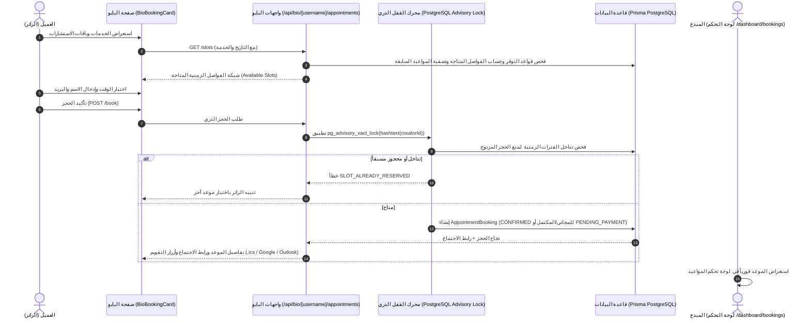

# خطة معمارية معتمدة: نظام تجارة الخدمات وحجز المواعيد الاحترافي المتكامل (EGM 2026)

## 1. الملخص التنفيذي والسياق (Executive Summary)
بناءً على التقييم السوقي التنافسي لعام 2026 وملاحظات تدقيق الجاهزية التنفيذية (EGM Implementation Readiness Audit):
> **المعيار السوقي:** تجارة الخدمات وحجز المواعيد (Bookings & Services)
> **الهدف التنافسي:** بناء نظام حجز استشارات وخدمات احترافي متكامل فائق الأداء (10 / 10) يتفوق على Stan Store و Calendly و Beacons.
> **الركائز الأساسية المحققة:**
> 1. **قفل ذري صارم (Advisory Lock + Interval Overlap):** استخدام `pg_advisory_xact_lock` لمنع سباق القراءة والتسجيل (Read-then-Insert Race) ومطابقة التقاطع الزمني الدقيق `(existing.startTime < input.endTime && existing.endTime > input.startTime)`.
> 2. **معالجة دقيقة للمناطق الزمنية (Timezones):** اعتماد توقيت مكة المكرمة (`Asia/Riyadh` UTC+3) الافتراضي وتخزين كافة التواريخ بصيغة UTC النقية في قاعدة البيانات مع عرض الفترات للمستخدم بتوقيته المحلي مع إشارة التوقيت.
> 3. **توليد روابط الاجتماعات وخيارات المبدع:** إتاحة رابط اجتماع مخصص للمبدع (Custom Zoom / Google Meet link) مع توليد احتياطي منظم لـ Google Meet، وتكامل تقويم Google و Outlook وملفات `.ics` لـ Apple Calendar.
> 4. **هندسة ملفات معيارية صارمة ($\le 250$ سطر):** تقسيم كروت ومسارات الحجز إلى مكونات فرعية متخصصة تحت `src/features/bio/components/booking/` و `src/features/appointments/server/`.

---

## 2. الهيكلية المعمارية وتدفق العمليات (Architecture & Flow)

---

## 3. هندسة البيانات والحالات (Data & State Engine)

### مصفوفة الحالات (State Transitions):
- `PENDING_PAYMENT`: قفل زمني مؤقت لمدة 10 دقائق (`lockedUntil = NOW() + 10m`). إذا انتهت المهلة يتم تجاهله تلقائياً.
- `CONFIRMED`: تأكيد نهائي، قفل دائم، إتاحة رابط الاجتماع، وإمكانية تصدير التقويم.
- `CANCELLED`: إلغاء الحجز من المبدع أو العميل مع تحرير الفترة الزمنية.
- `EXPIRED`: حجز مؤقت لم يكتمل سداده وانتهت مدة القفل.

---

## 4. خطة الحزم البرمجية وموازنة الأسطر الصارمة ($\le 250$ سطر)

### أ. خدمات ومسارات المعالجة الخلفية (`src/features/appointments/server/`):
1. `src/features/appointments/server/slot-locker.service.ts`: محرك القفل الذري باستخدام `pg_advisory_xact_lock` وفحص التداخل الزمني الدقيق ($\le 140$ سطر).
2. `src/features/appointments/server/appointments.scheduler.ts`: حاسبة الفترات الزمنية مع مراعاة مدة الخدمة (`durationMinutes`) والمنطقة الزمنية والحد الأدنى للمهلة ($\le 130$ سطر).
3. `src/features/appointments/server/services.service.ts`: إدارة باقات الاستشارات (جلب، إضافة، تعديل، حذف) ($\le 120$ سطر).
4. `src/features/appointments/server/availability.service.ts`: إدارة ساعات العمل وأيام التوفر الأسبوعية ($\le 110$ سطر).
5. `src/features/appointments/server/bookings.service.ts`: استعراض مواعيد المبدع وإحصائيات العوائد وتحديث الحالات مع التحقق من الملكية ($\le 140$ سطر).
6. `src/features/appointments/index.ts`: تجميع وتصدير كافة الخدمات والأنواع ($\le 60$ سطر).

### ب. المسارات البرمجية (API Routes):
1. `src/app/api/appointments/overview/route.ts`: إحصائيات المواعيد، الخدمات، وقواعد العمل للمبدع المصرح له ($\le 95$ سطر).
2. `src/app/api/appointments/services/route.ts`: إضافة وجلب باقات الخدمات للمبدع المصرح له ($\le 110$ سطر).
3. `src/app/api/appointments/services/[id]/route.ts`: حذف وتعديل الخدمة مع التحقق من الصلاحية ($\le 85$ سطر).
4. `src/app/api/appointments/availability/route.ts`: حفظ وجلب ساعات العمل الأسبوعية للمبدع المصرح له ($\le 95$ سطر).
5. `src/app/api/appointments/bookings/[id]/route.ts`: تحديث حالة الحجز (إلغاء أو تأكيد) من قبل المبدع ($\le 90$ سطر).
6. `src/app/api/bio/[username]/appointments/slots/route.ts`: واجهة عامة مع Rate Limit لحساب الفترات المتاحة حياً ($\le 95$ سطر).
7. `src/app/api/bio/[username]/appointments/book/route.ts`: واجهة الحجز الذري العامة مع Rate Limit وحساب `endTime` خادمياً حصراً ($\le 130$ سطر).

### ج. مكونات صفحة البايو العامة المعيارية (`src/features/bio/components/booking/`):
1. `src/features/bio/components/booking/BookingServiceStep.tsx`: استعراض باقات الاستشارات والأسعار والمدة ($\le 110$ سطر).
2. `src/features/bio/components/booking/BookingDateSlotStep.tsx`: محدد التاريخ الذكي وشبكة الفترات المتاحة مع مؤشر التوقيت المحلي ($\le 145$ سطر).
3. `src/features/bio/components/booking/BookingClientForm.tsx`: نموذج إدخال بيانات العميل والتحقق والتأكيد ($\le 130$ سطر).
4. `src/features/bio/components/booking/BookingConfirmationStep.tsx`: شاشة نجاح الحجز ورابط Google Meet وأزرار التقويم (.ics / Google / Outlook) ($\le 125$ سطر).
5. `src/features/bio/components/booking/BioBookingCard.tsx`: منسق الخطوات والواجهة الرئيسية المدمجة في البايو ($\le 140$ سطر).
6. `src/features/bio/components/BioPageContent.tsx`: تضمين `BioBookingCard` بأمان مع الحفاظ على حجم الملف ($\le 225$ سطر).
7. `src/features/bio/services/profile.service.ts`: جلب الخدمات الفعالة عبر `Promise.all` المتزامن مع المنتجات الرقمية دون إبطاء الصفحة ($\le 140$ سطر).

### د. مكونات استوديو المواعيد في لوحة تحكم المبدع (`/dashboard/bookings`):
1. `src/features/dashboard/components/DashboardSidebarNav.tsx`: إضافة "حجز المواعيد" بأيقونة `Calendar` ($\le 135$ سطر).
2. `src/app/(dashboard)/dashboard/bookings/page.tsx`: صفحة استوديو المواعيد المعيارية ($\le 25$ سطر).
3. `src/features/appointments/components/AppointmentsStudio.tsx`: منسق التبويبات الرئيسي (المواعيد، الخدمات، أوقات العمل) ($\le 140$ سطر).
4. `src/features/appointments/components/AppointmentsStatsCards.tsx`: بطاقات مؤشرات المواعيد (القادمة، المكتملة، الإيرادات) ($\le 90$ سطر).
5. `src/features/appointments/components/BookingsListTab.tsx`: جدول وفلاتر الحجوزات وإجراءات الانضمام للاجتماع والتأكيد/الإلغاء ($\le 180$ سطر).
6. `src/features/appointments/components/ServicesCatalogTab.tsx`: بطاقات الخدمات ونموذج إنشاء/تعديل خدمة مع رابط الاجتماع المخصص ($\le 190$ سطر).
7. `src/features/appointments/components/AvailabilityRulesTab.tsx`: جدول ساعات العمل الأسبوعية والتوفر ($\le 165$ سطر).
8. `src/features/dashboard/components/AppointmentsDashboardCard.tsx`: بطاقة المواعيد السريعة في `/dashboard` ($\le 95$ سطر).

---

## 5. خطة الاختبار والتحقق المتكامل (Verification Strategy)
- اختبارات القفل الذري ومنع الحجز المزدوج (`tests/unit/appointments-locker.test.ts`): محاكاة استدعائين متزامنين لنفس الفترة وتأكيد رفض الثاني بـ `SLOT_ALREADY_RESERVED`.
- اختبارات حساب الفترات والمناطق الزمنية (`tests/unit/appointments-scheduler.test.ts`): التحقق من مدة الخدمة (30 دقيقة مقابل 60 دقيقة) وتصفية المواعيد السابقة.
- اختبارات واجهات البرمجة الخلفية (`tests/unit/appointments-api.test.ts`): التحقق من مسارات الـ API وحساب `endTime` خادمياً.
- اختبارات واجهة المستخدم في البايو (`tests/unit/bio-booking-card.test.tsx`): التحقق من دورة الخطوات وعرض رابط الاجتماع.
- فحص عدد الأسطر لجميع الملفات والتأكد أن كل ملف $\le 250$ سطر تماماً.
- تشغيل بناء الإنتاج `npm run build` للتأكد من خلو المشروع من أي أخطاء.
