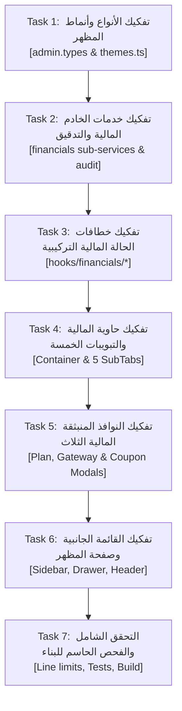

# تصميم نظام الهيكلية النمطية وتفكيك الملفات الكبيرة في المشروع
## (Feature Modular Structure & Architecture Refactoring Blueprint)

* **المؤلف (Author):** Ammar
* **الحالة (Status):** Ready for Implementation (All Goldfish Reviews Incorporated)
* **التاريخ (Date):** 2026-11-16
* **المرجع المعياري:** [`skills/feature-modular-structure/SKILL.md`](file:///home/ammar/AN%20LINKS/skills/feature-modular-structure/SKILL.md)
* **النطاق (Scope):** `src/features/admin/*`, `src/features/appearance/*`, `src/app/(dashboard)/dashboard/appearance/*`

---

## 1. المشكلة وسياق العمل (The Problem & Context)

تم تدقيق قاعدة شيفرة مشروع **AN LINKS** بالمقارنة مع معايير مهارة الهيكلية النمطية [`feature-modular-structure`](file:///home/ammar/AN%20LINKS/skills/feature-modular-structure/SKILL.md). تنص المهارة على قواعد معمارية حاسمة:
1. **المسؤولية الواحدة (Single Responsibility):** لكل ملف وظيفة واحدة واضحة وقابلة للوصف بجملة واحدة.
2. **حدود الحجم الصارمة (Size Limits):** المستهدف للملفات أقل من ~150 سطراً، وعند تجاوز 250 سطراً يجب تفكيك الملف فوراً إلى ملفات فرعية متخصصة، وألا تتجاوز الدوال 40 سطراً.
3. **فصل الطبقات وعدم التسريب (Layer Separation):** واجهة المستخدم لا تتصل بقاعدة البيانات أو منطق الخادم مباشرة، ومنطق الأعمال لا يقترن بمكونات التصيير.
4. **نقطة الدخول العامة (Public API via Index):** الوصول لأي ميزة يكون عبر ملفات الفهرسة والتجميع (Barrel files / `index.ts`) مع إبقاء التفاصيل الداخلية خاصة.
5. **صفر تراجع (Zero Regression):** الحفاظ التام على عمل كافة المسارات والاختبارات (54 ملف اختبار، 518/518 اختباراً ناجحاً) واجتياز بناء Next.js 15 بدون أي خطأ.

### حصر الملفات المتجاوزة لحد الـ 250 سطراً (The 15 Bloated Files)
كشف التدقيق الدقيق عن وجود **15 ملفاً** في المجلد `src/` تتجاوز حد الـ 250 سطراً (بإجمالي يتجاوز 5,000 سطر)، مفصلة في الجدول أدناه:

| # | المسار النسبي للملف | عدد الأسطر الحالي | المسؤولية الحالية | الاستهداف بعد التفكيك |
| :--- | :--- | :--- | :--- | :--- |
| 1 | `src/features/admin/server/admin-financials.service.ts` | 751 | عمليات الخادم المالية كاملة (بوابات، خطط، عملات، كوبونات، فواتير، تدقيق) | 6 خدمات نطاقية فرعية + خدمة تدقيق (<150 سطر لكل ملف) |
| 2 | `src/features/admin/components/payments/AdminFinancialsContainer.tsx` | 533 | إدارة حالة 6 تبويبات و4 نوافذ منبثقة والتنقل وإحصائيات المالية | حاوية مجمعة (<150 سطر) + مكونات فرعية متخصصة |
| 3 | `src/features/admin/hooks/useAdminFinancials.ts` | 500 | خطاف حالة ضخم يدير 6 كيانات وحالات التحميل والتغذية الراجعة والعمليات | خطاف تركيبي (<150 سطر) يجمع خطافات نطاق فرعية |
| 4 | `src/features/admin/types/admin.types.ts` | 406 | كافة أنواع ولوحات الإدارة في ملف واحد | 3 ملفات أنواع متخصصة يعاد تجميعها في برميل الأنواع |
| 5 | `src/features/admin/components/payments/tabs/PlanQuotasSubTab.tsx` | 399 | ضبط حدود وحصص باقات الاشتراك والمفاتيح المنطقية | تبويب مدمج (<140 سطر) + مكونات الحقول والحصص |
| 6 | `src/features/admin/components/payments/modals/PlanEditorModal.tsx` | 379 | نموذج تعديل الباقة والأسعار متعددة العملات والحدود | نافذة مدمجة (<140 سطر) + مصفوفة الأسعار والحقول العامة |
| 7 | `src/features/admin/components/payments/tabs/InvoicesTransactionsSubTab.tsx` | 324 | جدول المعاملات وتصفية الفواتير والصفحات والبحث | تبويب مدمج (<130 سطر) + شريط الفلترة وجدول الفواتير |
| 8 | `src/features/admin/components/payments/modals/GatewayConfigModal.tsx` | 318 | إعدادات وتشفير مفاتيح بوابات الدفع ورسوم المعاملات | نافذة مدمجة (<130 سطر) + حقول المفاتيح المشفرة والرسوم |
| 9 | `src/features/appearance/constants/themes.ts` | 307 | مصفوفة 12 سمة رئيسية + 6 أسماء بديلة للتوافق + الرموز المشتركة | ملفان: `theme-presets.ts` و `theme-tokens.ts` |
| 10 | `src/app/(dashboard)/dashboard/appearance/page.tsx` | 305 | صفحة تخصيص المظهر، درج الهاتف، الحفظ التلقائي والرأس | صفحة نظيفة (<140 سطر) + `MobilePhoneDrawer.tsx` و `AppearanceHeader.tsx` |
| 11 | `src/features/admin/components/payments/modals/CouponEditorModal.tsx` | 299 | نموذج إنشاء وتعديل كوبونات الخصم وقواعد الاستخدام | نافذة مدمجة (<130 سطر) + حقول الخصم ومحدد الباقات |
| 12 | `src/features/admin/components/payments/tabs/PlansSubTab.tsx` | 295 | عرض باقات الاشتراك والتبديل الشهري/السنوي والعمليات | تبويب مدمج (<120 سطر) + بطاقة الباقة وعنوان الدورات |
| 13 | `src/features/admin/components/payments/tabs/CouponsSubTab.tsx` | 282 | جدول أكواد الخصم والنسخ والتفعيل والتعطيل والحذف | تبويب مدمج (<120 سطر) + جدول وبطاقات الكوبونات |
| 14 | `src/features/admin/components/payments/tabs/GatewaysSubTab.tsx` | 281 | عرض بطاقات بوابات الدفع وتصنيفاتها وتبديل حالتها | تبويب مدمج (<120 سطر) + بطاقة البوابة وأقسام الفئات |
| 15 | `src/features/admin/components/AdminSidebar.tsx` | 280 | شريط التنقل الجانبي للإدارة مع الطي والتوسيع والروابط | شريط مجمع (<120 سطر) + الرأس، قائمة الروابط، والتذييل |

---

## 2. المعايير الهندسية الحاكمة (Engineering Principles)

1. **الامتثال الصارم لحد الأسطر (Strict Line Limits):**
   - لا يُسمح نهائياً بأي ملف يتجاوز 250 سطراً في `src/`.
   - الهدف المعياري لجميع الملفات الجديدة والمفككة هو أن تكون أقل من 150 سطراً.
   - الدوال لا تتجاوز 40 سطراً وفق المهارة.
2. **التوافق العكسي التام (100% Backward Compatibility):**
   - الإبقاء على الملفات الأصلية كملفات فهرسة وتجميع (Barrel files) تُعيد تصدير كافة الدوال والأنواع والمكونات.
   - عدم تعديل أي اسم دالة أو توقيع (Signature) أو Props للمكونات الأصلية لضمان عدم تأثر أي ملف خارجي أو اختبار.
3. **التفكيك المعماري وفصل الاهتمامات (Separation of Concerns):**
   - فصل خدمات التدقيق المالي في ملف مستقل لمنع التزاوج بين النطاقات (`audit.service.ts`).
   - فصل استدعاءات الشبكة للعميل (`admin-financials.client.ts`) عن خدمات الخادم (`financials/*.service.ts`).
   - وضع المكونات الفرعية المشتركة داخل مجلد الميزة المعنية (`src/features/appearance/components/MobilePhoneDrawer.tsx`).

---

## 3. القرارات المعمارية المعتمدة (Architectural Decisions)

### القرار 1: تفكيك خدمات الخادم المالية (`admin-financials.service.ts` -> 751 سطراً)
تفكيك الخدمة إلى 6 خدمات نطاقية فرعية متخصصة بالإضافة إلى خدمة التدقيق المالي داخل `src/features/admin/server/financials/`:
* `src/features/admin/server/financials/audit.service.ts` (~35 سطر): دالة `logFinancialAudit` لمنع الاقتران الدائري بين النطاقات.
* `src/features/admin/server/financials/overview.service.ts` (~45 سطر): دالة `getFinancialOverview`.
* `src/features/admin/server/financials/gateways.service.ts` (~75 سطر): دوال `getAdminGateways`, `updateAdminGateway`.
* `src/features/admin/server/financials/plans.service.ts` (~135 سطر): دوال `getAdminPlans`, `upsertAdminPlan`, `deleteAdminPlan`, `updateAdminPlanQuotas`.
* `src/features/admin/server/financials/currencies.service.ts` (~55 سطر): دوال `getAdminCurrencies`, `updateAdminCurrency`.
* `src/features/admin/server/financials/coupons.service.ts` (~115 سطر): دوال `getAdminCoupons`, `createAdminCoupon`, `toggleAdminCoupon`, `deleteAdminCoupon`.
* `src/features/admin/server/financials/invoices.service.ts` (~115 سطر): دوال `getAdminTransactions`, `refundAdminInvoice`.
* **ملف التجميع:** `src/features/admin/server/admin-financials.service.ts` يتحول إلى برميل تجميع وإعادة تصدير لكافة الدوال (<40 سطر).

### القرار 2: تفكيك خطاف الحالة المالية (`useAdminFinancials.ts` -> 500 سطراً)
اعتماد **نمط التركيب (Hook Composition Pattern)**:
* إنشاء خطافات فرعية تخصصية داخل `src/features/admin/hooks/financials/`:
  - `useFinancialsGateways.ts` (~65 سطر): `toggleGateway`, `updateGatewayConfig`.
  - `useFinancialsPlans.ts` (~85 سطر): `savePlan`, `deletePlan`, `saveQuotas`.
  - `useFinancialsCurrencies.ts` (~45 سطر): `saveCurrency`.
  - `useFinancialsCoupons.ts` (~90 سطر): `createCoupon`, `toggleCoupon`, `deleteCoupon`.
  - `useFinancialsTransactions.ts` (~45 سطر): `filterTransactions`.
* الخطاف المنسق الرئيسي `src/features/admin/hooks/useAdminFinancials.ts` (~140 سطر):
  - يدير التنسيق المشترك لدورة الحياة (`refreshData` عبر `Promise.allSettled`).
  - يدير حالات النظرة العامة `overview`, والتحميل `isLoading`, والحفظ `isSaving`, والخطأ `error`, والتغذية الراجعة `feedback`.
  - يضمن تطابق واجهة `ReturnType<typeof useAdminFinancials>` بنسبة 100%.

### القرار 3: تفكيك الأنواع المالية والإدارية (`admin.types.ts` -> 406 سطراً)
تفكيك الملف إلى 3 ملفات تخصصية داخل `src/features/admin/types/`:
* `src/features/admin/types/financial.types.ts` (~180 سطر): أنواع البوابات، الخطط، الأسعار، الحصص، العملات، الكوبونات، الفواتير، المعاملات، والنظرة العامة.
* `src/features/admin/types/platform.types.ts` (~110 سطر): أنواع المنصات والحسابات والروابط ومقاييس النظام.
* `src/features/admin/types/system.types.ts` (~70 سطر): أنواع سجلات النشاط، التكوينات العامة، والمسؤولين.
* **ملف التجميع:** `src/features/admin/types/admin.types.ts` و `index.ts` يعيدان تصدير كافة الأنواع دون أي كسر.

### القرار 4: تفكيك حاوية المالية والتبويبات الخمسة المتضخمة
1. **حاوية المالية `AdminFinancialsContainer.tsx` (533 سطراً):**
   - استخراج شريط تبويبات المالية: `FinancialsSubTabNav.tsx` (~60 سطر).
   - استخراج شريط ملخص الإحصائيات: `FinancialsStatsOverview.tsx` (~65 سطر).
   - استخراج مدير النوافذ المنبثقة: `FinancialsModalsManager.tsx` (~90 سطر).
   - تصبح الحاوية مجرد منسق أنيق بحجم ~110 أسطر.
2. **تبويب الحصص `PlanQuotasSubTab.tsx` (399 سطراً):**
   - استخراج `PlanQuotasNumericLimits.tsx` (~70 سطر).
   - استخراج `PlanQuotasFeatureSwitches.tsx` (~110 سطر).
   - التبويب الرئيسي يصبح ~120 سطراً.
3. **تبويب الفواتير والمعاملات `InvoicesTransactionsSubTab.tsx` (324 سطراً):**
   - استخراج `InvoicesFilterBar.tsx` (~60 سطر).
   - استخراج `InvoicesTable.tsx` (~120 سطر).
   - استخراج `InvoicesPagination.tsx` (~45 سطر).
   - التبويب الرئيسي يصبح ~95 سطراً.
4. **تبويب الباقات `PlansSubTab.tsx` (295 سطراً):**
   - استخراج بطاقة الباقة `PlanPricingCard.tsx` (~90 سطر).
   - استخراج شريط اختيار الدورة الزمنية `PlansCycleHeader.tsx` (~45 سطر).
   - التبويب الرئيسي يصبح ~105 أسطر.
5. **تبويب الكوبونات `CouponsSubTab.tsx` (282 سطراً):**
   - استخراج جدول الكوبونات وبطاقاتها `CouponsTable.tsx` (~110 سطر).
   - التبويب الرئيسي يصبح ~100 سطر.
6. **تبويب بوابات الدفع `GatewaysSubTab.tsx` (281 سطراً):**
   - استخراج بطاقة بوابة الدفع `GatewayCard.tsx` (~95 سطر).
   - استخراج قسم فئة البوابات `GatewayCategorySection.tsx` (~55 سطر).
   - التبويب الرئيسي يصبح ~95 سطراً.

### القرار 5: تفكيك النوافذ المنبثقة الثلاث المتضخمة
1. **نافذة تعديل الباقة `PlanEditorModal.tsx` (379 سطراً):**
   - استخراج مصفوفة أسعار العملات `PlanPricingMatrix.tsx` (~80 سطر).
   - استخراج الحقول العامة للباقة `PlanGeneralFields.tsx` (~85 سطر).
   - النافذة الرئيسية تصبح ~120 سطراً.
2. **نافذة إعدادات البوابة `GatewayConfigModal.tsx` (318 سطراً):**
   - استخراج حقول المفاتيح المشفرة `GatewaySecretFields.tsx` (~75 سطر).
   - استخراج إعدادات الرسوم والعملات `GatewayFeeSettings.tsx` (~65 سطر).
   - النافذة الرئيسية تصبح ~115 سطراً.
3. **نافذة محرر الكوبون `CouponEditorModal.tsx` (299 سطراً):**
   - استخراج حقول الخصم والصلاحية `CouponDiscountFields.tsx` (~75 سطر).
   - استخراج محدد الباقات والحدود `CouponPlanSelector.tsx` (~60 سطر).
   - النافذة الرئيسية تصبح ~110 أسطر.

### القرار 6: تفكيك القائمة الجانبية وصفحة المظهر
1. **القائمة الجانبية `AdminSidebar.tsx` (280 سطراً):**
   - استخراج الرأس وزر التوسيع/الطي: `AdminSidebarHeader.tsx` (~55 سطر).
   - استخراج قائمة روابط التنقل المصنفة: `AdminSidebarNavList.tsx` (~110 سطر).
   - استخراج تذييل روابط التنقل السريع (`/dashboard` و `/`): `AdminSidebarFooter.tsx` (~50 سطر) مع دعم كامل لخاصية `isCollapsedView: boolean`.
   - المكون الرئيسي `AdminSidebar.tsx` يصبح ~85 سطراً.
2. **صفحة تخصيص المظهر `dashboard/appearance/page.tsx` (305 سطراً):**
   - استخراج درج الهاتف الذكي في مسار الميزة: `src/features/appearance/components/MobilePhoneDrawer.tsx` (~75 سطر) وإعادة تصديره عبر `features/appearance/index.ts`.
   - استخراج شريط رأس الصفحة وحالة الحفظ: `src/features/appearance/components/AppearanceHeader.tsx` (~65 سطر).
   - صفحة `page.tsx` تصبح ~135 سطراً.
3. **ثوابت المظهر `themes.ts` (307 سطراً):**
   - استخراج واجهة `ThemeConfig` وكافة الـ 18 إدخالاً (12 سمة رئيسية + 6 أسماء بديلة): `src/features/appearance/constants/theme-presets.ts` (~180 سطر).
   - استخراج خيارات وأنماط التنسيق المشتركة: `src/features/appearance/constants/theme-tokens.ts` (~90 سطر).
   - الملف المجمع `themes.ts` يعيد تصدير كافة المتغيرات والأنماط (<35 سطر).

---

## 4. خطة المهام التنفيذية التفصيلية (Actionable SDD Tasks 1 - 7)

### المهمة 1: تفكيك الأنواع وأنماط المظهر (Types & Appearance Themes)
* **الإجراءات والمستهدفات:**
  - `[Create]` `src/features/admin/types/financial.types.ts`
  - `[Create]` `src/features/admin/types/platform.types.ts`
  - `[Create]` `src/features/admin/types/system.types.ts`
  - `[Modify/Barrel]` `src/features/admin/types/admin.types.ts` (إعادة التصدير لضمان التوافق)
  - `[Modify/Barrel]` `src/features/admin/types/index.ts`
  - `[Create]` `src/features/appearance/constants/theme-presets.ts` (مع تعريف `ThemeConfig` والـ 18 إدخالاً كاملاً)
  - `[Create]` `src/features/appearance/constants/theme-tokens.ts`
  - `[Modify/Barrel]` `src/features/appearance/constants/themes.ts`
* **معايير التحقق:** `npx tsc --noEmit` + تشغيل اختبارات `vitest run tests/integration/appearance.test.ts`.

### المهمة 2: تفكيك خدمات الخادم المالية والتدقيق (Financial Server Services & Audit)
* **الإجراءات والمستهدفات:**
  - `[Create]` `src/features/admin/server/financials/audit.service.ts` (`logFinancialAudit`)
  - `[Create]` `src/features/admin/server/financials/overview.service.ts` (`getFinancialOverview`)
  - `[Create]` `src/features/admin/server/financials/gateways.service.ts` (`getAdminGateways`, `updateAdminGateway`)
  - `[Create]` `src/features/admin/server/financials/plans.service.ts` (`getAdminPlans`, `upsertAdminPlan`, `deleteAdminPlan`, `updateAdminPlanQuotas`)
  - `[Create]` `src/features/admin/server/financials/currencies.service.ts` (`getAdminCurrencies`, `updateAdminCurrency`)
  - `[Create]` `src/features/admin/server/financials/coupons.service.ts` (`getAdminCoupons`, `createAdminCoupon`, `toggleAdminCoupon`, `deleteAdminCoupon`)
  - `[Create]` `src/features/admin/server/financials/invoices.service.ts` (`getAdminTransactions`, `refundAdminInvoice`)
  - `[Create/Barrel]` `src/features/admin/server/financials/index.ts`
  - `[Modify/Barrel]` `src/features/admin/server/admin-financials.service.ts`
* **معايير التحقق:** `npx tsc --noEmit` + تشغيل اختبارات الخادم `vitest run tests/unit/admin-financials-service.test.ts`.

### المهمة 3: تفكيك خطافات الحالة المالية التركيبية (Modular Composite Financial Hooks)
* **الإجراءات والمستهدفات:**
  - `[Create]` `src/features/admin/hooks/financials/useFinancialsGateways.ts`
  - `[Create]` `src/features/admin/hooks/financials/useFinancialsPlans.ts`
  - `[Create]` `src/features/admin/hooks/financials/useFinancialsCurrencies.ts`
  - `[Create]` `src/features/admin/hooks/financials/useFinancialsCoupons.ts`
  - `[Create]` `src/features/admin/hooks/financials/useFinancialsTransactions.ts`
  - `[Create/Barrel]` `src/features/admin/hooks/financials/index.ts`
  - `[Modify/Aggregator]` `src/features/admin/hooks/useAdminFinancials.ts` (الخطاف المنسق المجمع الذي يحفظ واجهة `ReturnType<typeof useAdminFinancials>`)
* **معايير التحقق:** `npx tsc --noEmit` + تشغيل اختبارات العميل `vitest run tests/unit/admin-financials-client.test.ts`.

### المهمة 4: تفكيك حاوية المالية والتبويبات الخمسة (Financials Container & 5 SubTabs)
* **الإجراءات والمستهدفات:**
  - `[Create]` `src/features/admin/components/payments/FinancialsSubTabNav.tsx`
  - `[Create]` `src/features/admin/components/payments/FinancialsStatsOverview.tsx`
  - `[Create]` `src/features/admin/components/payments/FinancialsModalsManager.tsx`
  - `[Modify]` `src/features/admin/components/payments/AdminFinancialsContainer.tsx` (<120 سطر)
  - `[Create]` `src/features/admin/components/payments/tabs/quotas/PlanQuotasNumericLimits.tsx`
  - `[Create]` `src/features/admin/components/payments/tabs/quotas/PlanQuotasFeatureSwitches.tsx`
  - `[Modify]` `src/features/admin/components/payments/tabs/PlanQuotasSubTab.tsx` (<130 سطر)
  - `[Create]` `src/features/admin/components/payments/tabs/invoices/InvoicesFilterBar.tsx`
  - `[Create]` `src/features/admin/components/payments/tabs/invoices/InvoicesTable.tsx`
  - `[Create]` `src/features/admin/components/payments/tabs/invoices/InvoicesPagination.tsx`
  - `[Modify]` `src/features/admin/components/payments/tabs/InvoicesTransactionsSubTab.tsx` (<110 سطر)
  - `[Create]` `src/features/admin/components/payments/tabs/plans/PlanPricingCard.tsx`
  - `[Create]` `src/features/admin/components/payments/tabs/plans/PlansCycleHeader.tsx`
  - `[Modify]` `src/features/admin/components/payments/tabs/PlansSubTab.tsx` (<110 سطر)
  - `[Create]` `src/features/admin/components/payments/tabs/coupons/CouponsTable.tsx`
  - `[Modify]` `src/features/admin/components/payments/tabs/CouponsSubTab.tsx` (<110 سطر)
  - `[Create]` `src/features/admin/components/payments/tabs/gateways/GatewayCard.tsx`
  - `[Create]` `src/features/admin/components/payments/tabs/gateways/GatewayCategorySection.tsx`
  - `[Modify]` `src/features/admin/components/payments/tabs/GatewaysSubTab.tsx` (<110 سطر)
* **معايير التحقق:** `npx tsc --noEmit` + تشغيل اختبارات حاوية المالية `vitest run tests/unit/admin-financials-container.test.tsx`.

### المهمة 5: تفكيك النوافذ المنبثقة المالية الثلاث (Modals Decomposition)
* **الإجراءات والمستهدفات:**
  - `[Create]` `src/features/admin/components/payments/modals/plans/PlanPricingMatrix.tsx`
  - `[Create]` `src/features/admin/components/payments/modals/plans/PlanGeneralFields.tsx`
  - `[Modify]` `src/features/admin/components/payments/modals/PlanEditorModal.tsx` (<130 سطر)
  - `[Create]` `src/features/admin/components/payments/modals/gateways/GatewaySecretFields.tsx`
  - `[Create]` `src/features/admin/components/payments/modals/gateways/GatewayFeeSettings.tsx`
  - `[Modify]` `src/features/admin/components/payments/modals/GatewayConfigModal.tsx` (<125 سطر)
  - `[Create]` `src/features/admin/components/payments/modals/coupons/CouponDiscountFields.tsx`
  - `[Create]` `src/features/admin/components/payments/modals/coupons/CouponPlanSelector.tsx`
  - `[Modify]` `src/features/admin/components/payments/modals/CouponEditorModal.tsx` (<120 سطر)
* **معايير التحقق:** `npx tsc --noEmit`.

### المهمة 6: تفكيك القائمة الجانبية وصفحة المظهر (Sidebar & Appearance Components)
* **الإجراءات والمستهدفات:**
  - `[Create]` `src/features/admin/components/sidebar/AdminSidebarHeader.tsx`
  - `[Create]` `src/features/admin/components/sidebar/AdminSidebarNavList.tsx`
  - `[Create]` `src/features/admin/components/sidebar/AdminSidebarFooter.tsx` (روابط التنقل السريع `/dashboard` و `/` مع خاصية `isCollapsedView`)
  - `[Modify]` `src/features/admin/components/AdminSidebar.tsx` (<110 سطر)
  - `[Create]` `src/features/appearance/components/MobilePhoneDrawer.tsx`
  - `[Create]` `src/features/appearance/components/AppearanceHeader.tsx`
  - `[Modify/Barrel]` `src/features/appearance/index.ts` (تصدير `MobilePhoneDrawer` و `AppearanceHeader`)
  - `[Modify]` `src/app/(dashboard)/dashboard/appearance/page.tsx` (<140 سطر)
* **معايير التحقق:** `npx tsc --noEmit` + تشغيل اختبارات القائمة الجانبية الاستجابية `vitest run tests/unit/admin-sidebar-responsive.test.tsx`.

### المهمة 7: التحقق الشامل والفحص الحاسم للبناء (Comprehensive Project Verification)
* **الإجراءات والمستهدفات:**
  - تشغيل سكربت الفحص الصارم للتحقق من أن **صفر ملفات في `src/` تتجاوز 250 سطراً**.
  - التحقق من تكامل Prisma: `npx prisma validate`.
  - تدقيق TypeScript الكامل: `npx tsc --noEmit`.
  - تشغيل حزمة الاختبارات الشاملة (54 ملف اختبار، 518+ اختباراً): `npm run test`.
  - تنفيذ بناء الإنتاج الكامل لـ Next.js 15: `npm run build`.

---

## 5. مصفوفة التحقق والخلو من الأخطاء (Zero-Defect Verification Checklist)
- [x] تم استيعاب وحل كافة ملاحظات الـ Blockers والـ Majors الصادرة من مدققي EGM.
- [ ] كل ملف من الملفات الـ 15 المذكورة انخفض حجمه إلى أقل من 150 سطراً (وبحد أقصى حتمي < 250 سطراً).
- [ ] كافة ملفات الـ Barrel تضمن التوافق العكسي 100% دون الحاجة لتعديل استيرادات المستهلكين الخارجيين.
- [ ] الحفاظ على اجتياز 100% من الاختبارات (518/518) وبناء Next.js بدون تحذيرات.
