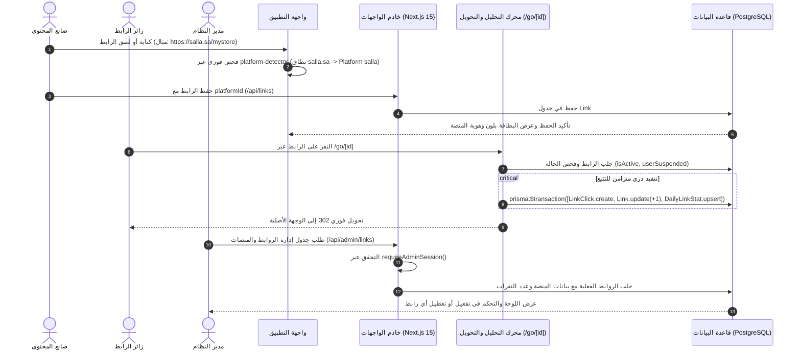

# تصميم نظام إدارة الروابط والمنصات (Links & Platforms Management System)

* **المؤلف (Author):** Ammar
* **الحالة (Status):** Approved (Post-Review Refined)
* **التاريخ (Date):** 2026-11-15
* **النطاق (Scope):** `prisma/schema.prisma`, `src/features/admin/*`, `src/features/links/*`, `src/app/api/admin/platforms/*`, `src/app/api/admin/links/*`, `src/app/api/platforms/*`, `src/app/api/links/*`, `src/app/go/[id]/*`

---

## 1. المشكلة وسياق العمل (The Problem & Context)

منظومة الروابط والمنصات الحالية في منصة AN LINKS تواجه أوجه قصور هيكلية تمنعها من العمل كنظام مركزي متكامل:

1. **غياب سجل المنصات المعتمد (Missing Platform Registry):**
   - منصات التواصل وشبكات المحتوى مشفرة بشكل ثابت داخل كود العميل في `SocialLinksEditor.tsx` و `categories.ts`، دون وجود جدول للمنصات في قاعدة البيانات.
   - لا يمكن لمدير النظام إضافة منصة جديدة (مثل Threads أو Anghami أو Salla) أو تعديل ألوانها ونطاقاتها الرسمية بدون تعديل الكود وإعادة النشر.

2. **عدم وجود كشف فوري للمنصات (No Dynamic URL Platform Detection):**
   - عندما يضيف صانع المحتوى رابطاً لمقطع يوتيوب أو متجر سلة، لا يتعرف النظام على المنصة تلقائياً ولا يربطه بالهوية البصرية الرسمية، مما يجبر المستخدم على إدخال العناوين واختيار الأيقونات يدوياً.

3. **غياب الحوكمة المركزية والرقابة للمشرف (No Central Link Governance):**
   - لوحة تحكم المشرف (`/admin`) تفتقر إلى تبويب متخصص لإدارة كافة الروابط المنشأة على مستوى المنصة، ومراقبة الروابط، ومتابعة إحصائيات توزيع الروابط حسب المنصات والأجهزة والبلدان.

4. **وجود شارات وهمية وافتقار تتبع النقرات للتحليل الجغرافي والتقني:**
   - بعض مكونات الواجهة (مثل `LinkCardItem.tsx` و `LinkHealthBanner.tsx`) تحتوي على نصوص وشارات فحص غير مرتبطة بخدمات حقيقية (`200 OK • سليم (72ms)`).
   - مسار التحويل `/go/[id]` يحتاج لترقية لتسجيل تفاصيل النقر (الدولة، الجهاز، المتصفح، ونظام التشغيل) وتخزينها في قاعدة البيانات.

---

## 2. الأهداف ونطاق العمل (Goals & Non-Goals)

### الأهداف (Goals)
1. **سجل المنصات الديناميكي (Dynamic Platform Registry):**
   - إنشاء جدول `Platform` في قاعدة البيانات يضم أكثر من 20 منصة عالمية وإقليمية ومحلية (فيديو، تواصل، موسيقى، تجارة، مراسلة، برمجيات) مع أسماء عربية وإنجليزية، ألوان رسمية، أنماط النطاقات (`domainPattern`)، وأيقونات معتمدة.
   - توفير واجهات برمجية كاملة محمية بصلاحيات المشرف (`requireAdminSession`) للتحكم بالمنصات وإضافة منصات جديدة.
2. **محرر الروابط في لوحة تحكم المستخدم (`/dashboard` Link Editor):**
   - كشف فوري للمنصة عند كتابة أو لصق الرابط (`Auto Platform Detection`) ومطابقته بالمنصة المعتمدة وتعيين أيقونتها ولونها داخل الذاكرة بزمن استجابة شبه فوري (< 1ms).
   - ربط محرر شبكات التواصل السريعة (`SocialLinksEditor`) مباشرة بدليل المنصات الفعلي في قاعدة البيانات، مع دعم أيقونات SVG لكافة المنصات.
   - ميزات الروابط المتقدمة: تثبيت الرابط في الأعلى (`isPinned`)، أرشفة الرابط (`isArchived`)، والتبديل الحي للحالة (`isActive`).
   - إزالة الشارات الوهمية وعرض عدادات النقرات التراكمية المسترجعة مباشرة من قاعدة البيانات.
3. **نظام تتبع النقرات والتحويل عالي الأداء (`Click Tracking & Redirect Pipeline`):**
   - ترقية معالج التحويل `/go/[id]` لتسجيل تفاصيل النقر: الدولة (عبر ترويسات `cf-ipcountry` و `x-vercel-ip-country`)، ونوع الجهاز، والمتصفح ونظام التشغيل عبر محلل خفيف (`src/shared/utils/device-detector.ts`).
   - تنفيذ عمليات التسجيل والتحديث بأسلوب ذري موحد عبر `prisma.$transaction([...])`، مع ضمان عدم تأثير أخطاء التتبع على سرعة التحويل 302.
4. **قسم مركزي لإدارة الروابط والمنصات في لوحة المشرف (`/admin` -> `links`):**
   - إضافة تبويب جديد كامل باسم «إدارة الروابط والمنصات» (`links`) في لوحة المدير.
   - يتضمن 3 تبويبات فرعية:
     1. **دليل المنصات (Platforms Catalog):** إضافة، تعديل، تفعيل/تعطيل، وترتيب المنصات. (مع استمرار تحويل الروابط الحالية حتى لو تم تعطيل المنصة من الكتالوج).
     2. **الإشراف على الروابط ومراجعتها (Links Moderation):** جدول تفاعلي بكافة الروابط المسجلة، إمكانية البحث باسم المستخدم أو الرابط أو المنصة، والتحكم بحالة الرابط.
     3. **تحليلات المنصات (Platform Analytics):** رسوم بيانية فعلية لتوزيع النقرات حسب المنصة، الأجهزة، والبلدان.
5. **تغذية بيانات المنصات الافتراضية (Platform Seed Data):**
   - دالة بذور `seedPlatforms(prisma)` في `prisma/seed-platforms.ts` مستدعاة من `prisma/seed.ts` لتغذية المنصات المعتمدة.

### غير الأهداف (Non-Goals)
- بناء شبكة زحف ويب خارجية كاملة لفحص محتوى المواقع الخارجية.
- تغيير نظام الدفع أو خطط الاشتراكات.

---

## 3. الخطة التقنية والمعمارية (Technical Architecture)

### 3.1 مخطط قاعدة البيانات (Database Schema Expansion)

```prisma
enum PlatformCategory {
  SOCIAL
  VIDEO
  MESSAGING
  COMMERCE
  DEV
  MUSIC
  PROFESSIONAL
  CUSTOM
}

model Platform {
  id              String            @id @default(cuid())
  slug            String            @unique // youtube, tiktok, x, instagram, salla, zid...
  nameAr          String            // يوتيوب، تيك توك، سلة...
  nameEn          String            // YouTube, TikTok, Salla...
  category        PlatformCategory  @default(SOCIAL)
  defaultIcon     String            // Lucide icon identifier (e.g. "youtube", "shopping-bag")
  brandColor      String            // e.g. #FF0000, #000000, #E1306C, #00B4D8
  domainPattern   String            // Pipe-separated domains: "youtube.com|youtu.be"
  urlPlaceholder  String            // e.g. "https://youtube.com/@channel"
  isEnabled       Boolean           @default(true) // Controls visibility in creator studio
  isVerified      Boolean           @default(true)
  sortOrder       Int               @default(0)
  createdAt       DateTime          @default(now())
  updatedAt       DateTime          @updatedAt

  links           Link[]
  socialLinks     SocialLink[]
  clicks          LinkClick[]

  @@index([category, isEnabled])
  @@index([sortOrder])
}

model Link {
  id              String          @id @default(cuid())
  userId          String
  user            User            @relation(fields: [userId], references: [id], onDelete: Cascade)
  platformId      String?
  platform        Platform?       @relation(fields: [platformId], references: [id], onDelete: SetNull)
  title           String
  url             String
  icon            String?
  description     String?
  position        Int             @default(0)
  isActive        Boolean         @default(true)
  isPinned        Boolean         @default(false)
  isArchived      Boolean         @default(false)
  clicksCount     Int             @default(0) // عداد إجمالي تراكمي سريع للنقرات
  createdAt       DateTime        @default(now())
  updatedAt       DateTime        @updatedAt

  clicks          LinkClick[]
  stats           DailyLinkStat[]

  @@index([userId, position])
  @@index([platformId])
  @@index([isActive, isArchived])
}

model SocialLink {
  id              String          @id @default(cuid())
  userId          String
  user            User            @relation(fields: [userId], references: [id], onDelete: Cascade)
  platformId      String?
  platform        Platform?       @relation(fields: [platformId], references: [id], onDelete: SetNull)
  network         String
  url             String
  position        Int             @default(0)

  @@index([userId, position])
  @@index([platformId])
}

model LinkClick {
  id          String    @id @default(cuid())
  linkId      String
  link        Link      @relation(fields: [linkId], references: [id], onDelete: Cascade)
  platformId  String?
  platform    Platform? @relation(fields: [platformId], references: [id], onDelete: SetNull)
  country     String?   // SA, AE, EG, US...
  city        String?
  device      String?   // MOBILE, DESKTOP, TABLET, UNKNOWN
  browser     String?   // Chrome, Safari, Firefox, Edge, Other
  os          String?   // iOS, Android, Windows, macOS, Linux, Other
  referer     String?
  createdAt   DateTime  @default(now())

  @@index([linkId, createdAt])
  @@index([platformId, createdAt])
  @@index([device])
  @@index([country])
  @@index([createdAt])
}
```

---

### 3.2 معمارية تدفق البيانات والتحويل (System Flow & Redirect Pipeline)



---

### 3.3 مصفوفة المنصات المدعومة (Supported Platforms Matrix)

| المنصة | الفئة | النطاقات المدعومة (`domainPattern`) | اللون المعتمد | الأيقونة المعتمدة (Lucide) |
|---|---|---|---|---|
| **YouTube** | VIDEO | `youtube.com\|youtu.be` | `#FF0000` | `youtube` |
| **TikTok** | SOCIAL | `tiktok.com` | `#000000` | `music-2` |
| **Instagram** | SOCIAL | `instagram.com` | `#E1306C` | `instagram` |
| **X (Twitter)** | SOCIAL | `x.com\|twitter.com` | `#000000` | `twitter` |
| **Snapchat** | SOCIAL | `snapchat.com` | `#FFFC00` | `ghost` |
| **WhatsApp** | MESSAGING | `wa.me\|whatsapp.com` | `#25D366` | `message-circle` |
| **Telegram** | MESSAGING | `t.me\|telegram.me` | `#0088CC` | `send` |
| **LinkedIn** | PROFESSIONAL | `linkedin.com` | `#0A66C2` | `linkedin` |
| **GitHub** | DEV | `github.com` | `#24292E` | `github` |
| **Spotify** | MUSIC | `spotify.com` | `#1DB954` | `disc` |
| **Apple Music**| MUSIC | `music.apple.com` | `#FA2D48` | `headphones` |
| **SoundCloud** | MUSIC | `soundcloud.com` | `#FF5500` | `radio` |
| **Anghami** | MUSIC | `anghami.com` | `#7928CA` | `music` |
| **Salla (سلة)** | COMMERCE | `salla.sa\|salla.com` | `#00B4D8` | `shopping-bag` |
| **Zid (زد)** | COMMERCE | `zid.sa\|zid.store` | `#6C5CE7` | `shopping-cart` |
| **Discord** | SOCIAL | `discord.gg\|discord.com` | `#5865F2` | `hash` |
| **Twitch** | VIDEO | `twitch.tv` | `#9146FF` | `tv` |
| **Facebook** | SOCIAL | `facebook.com\|fb.me` | `#1877F2` | `facebook` |
| **Pinterest** | SOCIAL | `pinterest.com` | `#E60023` | `pin` |
| **رابط مخصص (Fallback)** | CUSTOM | `.*` | `#4EDEA3` | `globe` |

---

### 3.4 واجهات وعقود البيانات (API Contracts & DTOs)

1. **`GET /api/platforms`**:
   - عام (متاح للمصادقين وغير المصادقين).
   - الاستجابة: `PlatformDTO[]` للمنصات النشطة (`isEnabled = true`) مرتبة حسب `sortOrder`.

2. **`GET /api/admin/platforms` & `POST /api/admin/platforms`**:
   - محمي عبر `requireAdminSession()`.
   - المدخلات لـ POST / PATCH:
     ```ts
     interface PlatformUpsertInput {
       slug: string;
       nameAr: string;
       nameEn: string;
       category: PlatformCategory;
       defaultIcon: string;
       brandColor: string;
       domainPattern: string;
       urlPlaceholder: string;
       isEnabled?: boolean;
       sortOrder?: number;
     }
     ```

3. **`GET /api/admin/links`**:
   - استعلامات البحث: `?search=&platformId=&status=all|active|inactive|pinned&page=1&limit=20`
   - الاستجابة:
     ```ts
     interface AdminLinksResponse {
       items: Array<{
         id: string;
         title: string;
         url: string;
         clicksCount: number;
         isActive: boolean;
         isPinned: boolean;
         isArchived: boolean;
         user: { id: string; name: string | null; email: string; username: string | null };
         platform: { id: string; slug: string; nameAr: string; nameEn: string; brandColor: string } | null;
         createdAt: string;
       }>;
       total: number;
       page: number;
       totalPages: number;
     }
     ```

4. **`PATCH /api/admin/links/[id]`**:
   - تعديل حالة الرابط: `{ isActive?: boolean; isPinned?: boolean; isArchived?: boolean }`.

5. **`GET /api/admin/links/analytics`**:
   - إحصائيات حقيقية:
     ```ts
     interface AdminPlatformAnalyticsResponse {
       totalLinks: number;
       totalClicks: number;
       activePlatformsCount: number;
       platformBreakdown: Array<{ slug: string; nameAr: string; nameEn: string; brandColor: string; clicks: number; linksCount: number }>;
       deviceBreakdown: Array<{ device: string; count: number; percentage: number }>;
       countryBreakdown: Array<{ country: string; count: number; percentage: number }>;
       topLinks: Array<{ id: string; title: string; url: string; clicksCount: number; username: string }>;
     }
     ```

---

## 4. البدائل المدروسة (Alternatives Considered)

1. **الاعتماد على الكشف عبر الطرف الثالث (Third-party Link Unfurl API):**
   - *الرفض:* استدعاء APIs خارجية عند كل إدخال رابط يضيف زمن تأخير عالي وتكلفة تشغيلية، بينما محرك المطابقة المحلي المعتمد على مطابقة النطاقات داخل الذاكرة يعمل في أقل من 1 ميلي ثانية.
2. **تخزين المنصات في ملف JSON ثابت:**
   - *الرفض:* لا يتيح لمدير النظام إضافة منصات جديدة أو تعديل ألوانها ونطاقاتها من لوحة المشرف دون إعادة نشر الكود البرمجي؛ وجود جدول `Platform` في قاعدة البيانات يمنح المنصة حوكمة ديناميكية كاملة.
3. **تتبع النقرات في ذاكرة التخزين المؤقت (Redis) فقط:**
   - *الرفض:* قد يؤدي لفقدان الإحصائيات التاريخية؛ التصميم يعتمد على الحفظ المتزامن السريع في قاعدة البيانات عبر معاملات ذرية مع فهارس مخصصة.

---

## 5. خطة التنفيذ التفصيلية (Detailed Implementation Plan)

### Task 1: توسيع مخطط Prisma وإنشاء سكريبت البذور للمنصات
- تعديل `prisma/schema.prisma` بإضافة نموذج `PlatformCategory` و `Platform` وتحديث `Link`, `SocialLink`, و `LinkClick`.
- كتابة `prisma/seed-platforms.ts` وتصدير دالة `seedPlatforms(prisma: PrismaClient)` لتغذية المنصات العشرين المعتمدة.
- استدعاء `seedPlatforms` داخل `prisma/seed.ts` وتشغيل البذر عبر `npm run seed`.
- التحقق: `npx prisma validate`, `npm run seed`, `npx tsc --noEmit`.

### Task 2: محرك الكشف الخوارزمي النقي والخدمات الخلفية
- ملف `src/features/links/services/platform-detector.ts`: أداة مطابقة نقية ومتوافقة مع العميل والخادم تعتمد على `new URL(url).hostname` ومطابقة آمنة بـ `.endsWith()`.
- ملف `src/shared/utils/device-detector.ts`: محلل خفيف لـ User-Agent يستخرج الأجهزة والأنظمة والمتصفحات بنقاء تام.
- ملف `src/features/admin/server/admin-links.service.ts`: استعلامات حقيقية لحوكمة المنصات وإدارة الروابط وتجميع الإحصائيات.
- مسارات واجهات المشرف:
  - `src/app/api/admin/platforms/route.ts` (GET / POST)
  - `src/app/api/admin/platforms/[id]/route.ts` (PATCH / DELETE)
  - `src/app/api/admin/links/route.ts` (GET الروابط المفلترة)
  - `src/app/api/admin/links/[id]/route.ts` (PATCH تحديث حالة الرابط)
  - `src/app/api/admin/links/analytics/route.ts` (GET الإحصائيات الحقيقية)
  جميعها محمية بـ `requireAdminSession()`.
- مسار واجهة المنصات العامة: `src/app/api/platforms/route.ts` (GET).
- تحديث مسار الروابط الرئيسي `src/app/api/links/route.ts` و `links.types.ts` لدعم `platformId`, `isPinned`, `isArchived`, `clicksCount`.

### Task 3: ترقية محرك التحويل وتتبع النقرات الفعلي (`/go/[id]`)
- تحديث `src/features/analytics/services/tracking.service.ts`:
  - قراءة كود الدولة الحقيقي (`cf-ipcountry`, `x-vercel-ip-country`, استبعاد `"XX"`).
  - استخدام `device-detector.ts` لتحليل الجهاز والمتصفح ونظام التشغيل.
  - تنفيذ عملية التتبع الذرية `prisma.$transaction([LinkClick.create, Link.update, DailyLinkStat.upsert])`.
- تحديث `src/app/go/[id]/route.ts` مع سياسة عدم تعطيل التحويل 302 عند فشل التسجيل، واستمرار تحويل الروابط حتى لو كانت المنصة غير نشطة في الكتالوج.

### Task 4: ترقية محرر الروابط لصانع المحتوى وتنظيف البيانات الوهمية
- تحديث `src/shared/ui/SocialIcons.tsx`: دعم أيقونات SVG لكافة المنصات العشرين مع تعيين `GenericLinkIcon` كبديل آمن.
- تحديث `AddLinkForm.tsx`: استخدام `platform-detector.ts` للكشف الفوري عن المنصة وعرض هويتها البصرية.
- تحديث `LinkCardItem.tsx`: إزالة الشارات الوهمية (`200 OK • سليم (72ms)`) وعرض شارة المنصة واللون وعداد النقرات الفعلي.
- تحديث `LinkHealthBanner.tsx`: تحويله إلى ملخص إحصائي حقيقي أو تنظيف العبارات الوهمية.
- تحديث `SocialLinksEditor.tsx`: استهلاك المنصات من `/api/platforms` بدلاً من المصفوفة الثابتة.

### Task 5: بناء تبويب إدارة الروابط والمنصات في لوحة المشرف (`/admin`)
- إضافة تبويب `links` في `AdminTabKey` وتحديث `TAB_TITLES` في `src/app/(admin)/admin/page.tsx` و `useAdminConsole.ts`.
- بناء مكونات التبويب في `src/features/admin/components/links/`:
  - `AdminLinksContainer.tsx`: حاوية التبويبات الفرعية الثلاثة.
  - `PlatformsCatalogSubTab.tsx`: دليل المنصات، تفعيل/تعطيل، وإضافة/تعديل المنصة.
  - `LinksModerationSubTab.tsx`: جدول جميع الروابط، بحث، تصفية حسب المنصة، وتعطيل الروابط.
  - `PlatformAnalyticsSubTab.tsx`: رسوم بيانية فعلية لتوزيع النقرات حسب المنصة والأجهزة والبلدان.
- ربط التبويب داخل `src/app/(admin)/admin/page.tsx` وإعادة التصدير في `src/features/admin/index.ts`.

### Task 6: اختبارات الوحدة والتكامل
- كتابة `tests/unit/platform-detector.test.ts`: اختبار كشف الروابط للمنصات العشرين وحالات الخطأ.
- كتابة `tests/unit/device-detector.test.ts`: اختبار تحليل User-Agent لمختلف الأجهزة والمتصفحات.
- كتابة `tests/unit/admin-links-service.test.ts`: اختبارات خدمات المشرف والاستعلامات التحليلية.
- كتابة `tests/integration/link-tracking.test.ts`: اختبار تدفق التحويل وتسجيل النقرات وتحديث العدادات بدقة.
- كتابة `tests/unit/admin-links-ui.test.tsx`: اختبار تصيير تبويب المنصات والروابط عبر `renderToStaticMarkup`.

### Task 7: التحقق الشامل وبناء بيئة الإنتاج
- `npx prisma validate`
- `npx tsc --noEmit`
- `npm run test` (كافة الاختبارات تمر بنسبة 100%)
- `npm run build` (بناء Next.js 15 يكتمل بنجاح تام لجميع المسارات)
