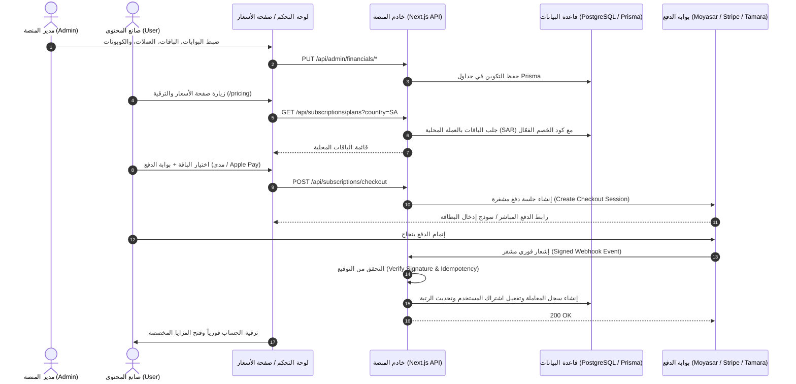

# نظام إدارة بوابات الدفع والاشتراكات المالية والعملات والعروض (Admin Billing & Payment Management)

* **Author:** Ammar
* **Status:** Approved
* **Date:** 2026-11-14

---

## Overview

توفر منصة **AN LINKS** نظاماً شاملاً لإدارة بوابات الدفع والاشتراكات المالية، يتيح لمدير المنصة (Super Admin) التحكم المركزي في تفعيل وإعداد بوابات الدفع المحلية (السعودية والخليجية ومصر: مدى، STC Pay، تمارا، تابي، فوري) والعالمية (Stripe، PayPal، Apple Pay، Google Pay، البطاقات الائتمانية)، وضبط تسعير الاشتراكات، والتحكم في نسب العمولات، وإدارة العملات المتعددة حسب الدولة تلقائياً، وتخصيص الباقات بمحددات وميزات دقيقة، وإنشاء العروض الترويجية وأكواد الخصم، كل ذلك ضمن لوحة تحكم إدارية موحدة ومقسمة إلى تبويبات تخصصية (Tabbed Interface).

## The Problem

1. **القصور في البنية الحالية للوحة الإدارة:**
   تقتصر صفحة المدفوعات الحالية (`AdminPaymentsTab.tsx`) على إعدادات تجريبية ثابتة (Mock Data) لـ 5 بوابات وباقة Pro واحدة فقط بنظام سعر وحيد بالريال السعودي، دون إمكانية حقيقية لإضافة باقات جديدة أو تعديل العملات أو ضبط قواعد التخصيص.
2. **تعدد الأسواق وغياب التسعير المحلي (Multi-currency by Country):**
   جمهور المنصة يمتد عبر دول الخليج ومصر والوطن العربي والعالم. إلزام جميع المستخدمين بعملة واحدة (مثل USD أو SAR) يقلل معدل التحويل (Conversion Rate)، ويفرض رسوم تحويل بنكي على المستخدم، ويتجاهل القدرة الشرائية المتفاوتة لكل دولة.
3. **غياب مرونة الباقات والحدود (Plan Tiers & Feature Flags):**
   تحتاج المنصة لإطلاق باقات مرنة (مجانية، صانع محتوى، أعمال، وكالات) وتحديد صلاحيات كل باقة بدقة (مثل عدد الروابط، إتاحة النطاق المخصص، القوالب المدفوعة، إزالة الشعار، تقارير التحليلات المتقدمة) دون الحاجة لتعديل الكود في كل مرة.
4. **فقدان إدارة العروض وأكواد الخصم (Promotions & Coupons):**
   لا توجد آلية إدارية لتوليد أكواد ترويجية مخصصة، أو حملات تخفيض محددة بفترة زمنية أو سقف استخدام، مما يعيق استراتيجيات النمو والتسويق والشراكات مع المؤثرين.
5. **تعقيد واجهة الإدارة وازدحامها:**
   دمج البوابات، الاشتراكات، العملات، والعروض في شاشة واحدة غير مقسمة يربك مسؤول النظام؛ والحل هو تقسيم وظيفي هيكلي على شكل تبويبات واضحة ومنظمة.

## Goals

1. **تفكيك واجهة إدارة المدفوعات إلى تبويبات تخصصية (Tab-based Modular Architecture):**
   تقسيم واجهة الإدارة المالية إلى 6 تبويبات مستقلة:
   - **التبويب 1: بوابات الدفع (Payment Gateways):** إدارة وتفعيل البوابات الوطنية والعالمية وضبط مفاتيح الربط والوضع التجريبي (Sandbox/Live) ورسوم البوابة.
   - **التبويب 2: باقات الاشتراكات (Subscription Plans):** إنشاء وتعديل وأرشفة باقات الاشتراك (Free, Creator, Pro, Agency) مع دورات الفوترة (شهري، سنوي، مدى الحياة).
   - **التبويب 3: محددات وتخصيص الباقات (Plan Features & Limits):** ضبط صلاحيات وحدود كل باقة (عدد الروابط، القوالب المتاحة، النطاقات المخصصة، إزالة الشعار، التحليلات، فرق العمل).
   - **التبويب 4: العملات والدول (Currencies & Localization):** إدارة العملات المدعومة، ربط كل دولة بالعملة الافتراضية، ضبط أسعار التحويل، وإتاحة تسعير مخصص ومستقل لكل دولة (Purchasing Power Parity).
   - **التبويب 5: العروض والتخفيضات (Promotions & Coupons):** إنشاء وإدارة أكواد الخصم، تحديد نوع الخصم (نسبة مئوية أو مبلغ ثابت)، مدة الصلاحية، الحد الأقصى للاستخدامات، والباقات المستهدفة.
   - **التبويب 6: الفواتير وسجل العمليات والعمولات (Transactions & Invoices):** استعراض سجل المدفوعات، حالات الاشتراك (Active, Past Due, Canceled)، الفواتير، ونسب عمولات مبيعات المتاجر الرقمية.
2. **دعم البوابات الوطنية والعالمية عبر وسيط دفع موحد (Payment Orchestration):**
   هيكلة محول موحد (Payment Adapter Pattern) يدعم مزودي الدفع المباشرين أو منصات الدفع الوسيطة المعتمدة في المنطقة (Moyasar, Tap, Stripe, Tamara) مع فحص تلقائي لسلامة الاتصال (Health Check / Ping).
3. **التسعير متعدد العملات مع الكشف التلقائي (Geo-Currency Detection):**
   تحديد بلد الزائر تلقائياً (عبر ترويسات Cloudflare / Vercel أو GeoIP) وعرض العملة المحلية المطابقة مع تمكين الزائر من التبديل اليدوي للعملة.
4. **تكامل البيانات وحفظ سجل التدقيق (Audit Logging & Data Integrity):**
   حفظ جميع التغييرات التي يجريها المدير في إعدادات البوابات والأسعار والعروض بسجل تدقيق (Audit Trail) لمنع التلاعب وتتبع الأخطاء.

## Non-Goals

1. **بناء معالج دفع بنكي مباشر (Direct Merchant Acquirer Engine):**
   لن تقوم المنصة بدور البنك المستحوذ؛ بل تعتمد بنسبة 100% على واجهات برمجة التطبيقات (APIs) ومستمعات الـ Webhooks الموثقة رسمياً من بوابات الدفع المعتمدة (مثل Moyasar, Tap Payments, Stripe, Tamara).
2. **إصدار الفوترة الإلكترونية الضريبية المتقدمة (ZATCA Phase 2 Integration) في هذه المرحلة:**
   تكتفي المنصة في هذه المرحلة بإنشاء فواتير إلكترونية رقمية بصيغة PDF وتوافق متطلبات المرحلة الأولى (Phase 1) فقط، وتأجيل الربط المشفر المباشر مع هيئة الزكاة والضريبة والجمارك (ZATCA Phase 2) لمرحلة لاحقة.
3. **الدفع الداخلي للمتاجر الفردية الخاصة بالمستخدمين:**
   هذا النظام مخصص حصرياً لاشتراكات منصة AN LINKS نفسها وعمولة مبيعات المنصة، ولا يشمل بناء نظام Checkout مخصص لبيع السلع المادية بين المستخدمين ومتابعيهم داخل هذا المكون.

## Open Questions

* **سؤال 1 (بوابة الدفع المركزية للمنطقة):** هل يفضل الاعتماد على بوابة موحدة للشرق الأوسط تجمع (مدى، Apple Pay، البطاقات، KNET) مثل **Moyasar** أو **Tap Payments** أو **Paylink**، أم بناء ربط منفصل لكل بوابة على حدة؟
* **سؤال 2 (تحديث أسعار صرف العملات):** هل يتم تثبيت أسعار تحويل العملات يدوياً من قبل إدارة المنصة لكل باقة، أم يتم ربطها بـ API خارجي لأسعار الصرف اللحظية مع هامش ربح (Spread Margin)؟
* **سؤال 3 (سياسة الاشتراكات السابقة عند تعديل الباقات):** عند تعديل سعر أو حدود باقة حالية، هل يُطبق السعر الجديد على المشتركين الحاليين فور التجديد، أم يتم الاحتفاظ بالسعر القديم لهم (Grandfathering Policy)؟

---

## Technical Plan (Architecture)

### 1. الهيكل العام للواجهة ومكونات التبويبات (Tab-Based UI Architecture)

يتم استبدال المكون الأحادي `AdminPaymentsTab.tsx` ببنية معيارية مكونة من حاوية رئيسية وشبكة تبويبات تخصصية، وفقاً لنمط الميزات الموجهة (`src/features/admin/components/payments/`):

```text
src/features/admin/components/payments/
├── AdminFinancialsContainer.tsx           # الحاوية الرئيسية ومحدد التبويبات (Sub-Tab Navigation)
├── tabs/
│   ├── GatewaysSubTab.tsx                 # التبويب 1: بوابات الدفع الوطنية والعالمية وضبط المفاتيح
│   ├── PlansSubTab.tsx                    # التبويب 2: إدارة باقات الاشتراكات (إضافة، تعديل، أرشفة)
│   ├── PlanQuotasSubTab.tsx               # التبويب 3: محددات وتخصيص مزايا كل باقة (Feature Limits)
│   ├── CurrenciesSubTab.tsx               # التبويب 4: العملات والدول وأسعار الصرف والكشف التلقائي
│   ├── CouponsSubTab.tsx                  # التبويب 5: العروض الترويجية وأكواد الخصم وحدود الاستخدام
│   └── InvoicesTransactionsSubTab.tsx     # التبويب 6: سجل المعاملات، الفواتير، ونسب عمولة المبيعات
├── modals/
│   ├── GatewayConfigModal.tsx             # نافذة إعداد المفاتيح السرية وحالة البوابة
│   ├── PlanEditorModal.tsx                # نافذة إضافة/تعديل باقة باشتراكاتها
│   ├── CouponEditorModal.tsx              # نافذة إنشاء كوبون خصم جديد
│   └── CurrencyRateModal.tsx              # نافذة ضبط سعر الصرف والبلدان المرتبطة
└── hooks/
    └── useAdminFinancials.ts              # خطاف تفاعلي لإدارة الحالة وعمليات الحفظ والتزامن
```

### 2. مخطط تدفق البيانات والمدفوعات (Data Flow & Payment Orchestration)

يوضح المخطط التالي تدفق دورة حياة تفعيل البوابات، اشتراك المستخدم، معالجة الويب هوك، وتحديث الصلاحيات:



### 3. نموذج البيانات الممتد في قاعدة البيانات (Prisma Schema Architecture)

توسيع ملف `prisma/schema.prisma` ليشمل الجداول المالية المخصصة:

```prisma
// 1. بوابات الدفع الوطنية والعالمية
model PaymentGateway {
  id                  String   @id @default(cuid())
  code                String   @unique // mada, apple_pay, stc_pay, tamara, tabby, stripe, paypal
  nameAr              String
  nameEn              String
  category            String   // NATIONAL | INTERNATIONAL | BNPL | WALLET
  isEnabled           Boolean  @default(false)
  isTestMode          Boolean  @default(true)
  publishableKey      String?
  secretKeyEncrypted  String?  // مشفر في قاعدة البيانات
  webhookSecret       String?
  feePercentage       Float    @default(0.0) // عمولة البوابة المقتطعة
  feeFixed            Float    @default(0.0) // رسوم ثابتة لكل عملية
  supportedCurrencies String[] // ["SAR", "AED", "USD", ...]
  sortOrder           Int      @default(0)
  createdAt           DateTime @default(now())
  updatedAt           DateTime @updatedAt
}

// 2. باقات الاشتراكات الأساسية
model SubscriptionPlan {
  id             String              @id @default(cuid())
  slug           String              @unique // free, creator, pro, agency
  nameAr         String
  nameEn         String
  descriptionAr  String?
  badgeAr        String?             // "الأكثر شعبية", "عرض خاص"
  isActive       Boolean             @default(true)
  sortOrder      Int                 @default(0)
  prices         PlanPrice[]
  quotas         PlanQuota?
  subscriptions  UserSubscription[]
  createdAt      DateTime            @default(now())
  updatedAt      DateTime            @updatedAt
}

// 3. تسعير الباقة متعدد العملات وفترات الفوترة
model PlanPrice {
  id             String           @id @default(cuid())
  planId         String
  plan           SubscriptionPlan @relation(fields: [planId], references: [id], onDelete: Cascade)
  currency       String           // SAR, AED, USD, EGP, KWD
  billingCycle   String           // MONTHLY, YEARLY, LIFETIME
  amount         Float            // المبلغ الفعلي للدفع
  originalAmount Float?           // المبلغ قبل الخصم (لإظهار الشطب والتوفير)
  isActive       Boolean          @default(true)
  externalPriceId String?         // المعرف المرتبط في Stripe أو Moyasar
  
  @@unique([planId, currency, billingCycle])
}

// 4. محددات وصلاحيات وتخصيص الباقة (Feature Quotas)
model PlanQuota {
  id                     String           @id @default(cuid())
  planId                 String           @unique
  plan                   SubscriptionPlan @relation(fields: [planId], references: [id], onDelete: Cascade)
  maxLinks               Int              @default(10) // عدد الروابط المسموحة
  allowCustomDomain      Boolean          @default(false) // ربط دومين خاص
  allowRemoveBranding    Boolean          @default(false) // إخفاء شعار المنصة
  allowAdvancedThemes    Boolean          @default(false) // قوالب CSS وخلفيات الفيديو
  allowDetailedAnalytics Boolean          @default(false) // إحصائيات دقيقة ومصادر الزيارات
  allowPrioritySupport   Boolean          @default(false) // دعم فني مخصص
  customCssAllowed       Boolean          @default(false)
  storeCommissionRate    Float            @default(5.0) // نسبة عمولة المنصة من مبيعات المتجر الرقمي للمستخدم
}

// 5. العملات والدول المرتبطة
model CurrencyConfig {
  code              String   @id // SAR, AED, USD, KWD, EGP, EUR
  nameAr            String
  symbol            String   // ر.س, د.إ, $, ج.م
  exchangeRateToUSD Float    // سعر الصرف مقابل الدولار
  isBaseCurrency    Boolean  @default(false)
  isActive          Boolean  @default(true)
  autoDetectCountries String[] // ["SA"], ["AE"], ["EG", "SD"]
  updatedAt         DateTime @updatedAt
}

// 6. العروض الترويجية وأكواد الخصم
model PromotionCoupon {
  id                  String   @id @default(cuid())
  code                String   @unique // مثلاً: SAUDI94, LAUNCH50
  descriptionAr       String?
  discountType        String   // PERCENTAGE | FIXED_AMOUNT
  discountValue       Float    // قيمة الخصم (مثلاً 20 لـ 20%، أو 50 ريال)
  maxUses             Int?     // أقصى عدد لاستخدام الكوبون إجمالاً
  usedCount           Int      @default(0)
  maxUsesPerUser      Int      @default(1)
  validFrom           DateTime @default(now())
  validUntil          DateTime?
  isActive            Boolean  @default(true)
  applicablePlanSlugs String[] // الباقات المسموح تطبيق الخصم عليها
  createdAt           DateTime @default(now())
}

// 7. اشتراكات المستخدمين الفعلية
model UserSubscription {
  id                   String           @id @default(cuid())
  userId               String
  user                 User             @relation(fields: [userId], references: [id], onDelete: Cascade)
  planId               String
  plan                 SubscriptionPlan @relation(fields: [planId], references: [id])
  status               String           @default("ACTIVE") // ACTIVE, PAST_DUE, CANCELED, EXPIRED
  billingCycle         String           // MONTHLY, YEARLY, LIFETIME
  currency             String
  amountPaid           Float
  couponCode           String?
  gatewayCode          String           // mada, stripe, tamara
  gatewaySubscriptionId String?
  currentPeriodStart   DateTime         @default(now())
  currentPeriodEnd     DateTime
  cancelAtPeriodEnd    Boolean          @default(false)
  createdAt            DateTime         @default(now())
  updatedAt            DateTime         @updatedAt

  @@index([userId, status])
}

// 8. سجل المعاملات المالية والفواتير
model FinancialInvoice {
  id                String   @id @default(cuid())
  invoiceNumber     String   @unique // INV-2026-0001
  userId            String
  user              User     @relation(fields: [userId], references: [id], onDelete: Cascade)
  amountSubtotal    Float
  discountAmount    Float    @default(0.0)
  taxAmount         Float    @default(0.0) // ضريبة القيمة المضافة 15% (KSA)
  amountTotal       Float
  currency          String
  gatewayCode       String
  gatewayTxId       String?
  status            String   // PAID, FAILED, REFUNDED
  pdfUrl            String?
  createdAt         DateTime @default(now())
}
```

### 4. واجهات برمجة التطبيقات (API Routes & Contract)

#### واجهات لوحة الإدارة (`src/app/api/admin/financials/`):
* `GET /api/admin/financials/overview`: إرجاع الحالة العامة، البوابات، الباقات، العملات، ملخص الإيرادات.
* `PUT /api/admin/financials/gateways`: تحديث إعدادات بوابة معينة، تفعيل/تعطيل، وتحديث مفاتيح الربط.
* `POST /api/admin/financials/plans`: إضافة نوع اشتراك جديد مع أسعاره المحددة ومحددات الصلاحيات.
* `PUT /api/admin/financials/plans/[id]`: تعديل أسعار أو ميزات أو حالة باقة موجودة.
* `DELETE /api/admin/financials/plans/[id]`: أرشفة الباقة لمنع المشتركين الجدد من اختيارها.
* `PUT /api/admin/financials/currencies`: ضبط أسعار الصرف والدول المرتبطة وتفعيل/تعطيل عملات.
* `POST /api/admin/financials/coupons`: إنشاء كود ترويجي جديد وتحديد سقف الاستخدامات والتواريخ.
* `DELETE /api/admin/financials/coupons/[id]`: إلغاء تفعيل أو حذف كود الخصم.
* `GET /api/admin/financials/transactions`: استعلام متقدم لعمليات الدفع مع إمكانية الفلترة بالبوابة، الحالة، التاريخ، والعملة.

#### واجهات تجربة العميل والاشتراك (`src/app/api/subscriptions/`):
* `GET /api/subscriptions/plans`: إرجاع الباقات المتاحة بالعملة المكتشفة تلقائياً لبلد العميل أو العملة المحددة يدوياً.
* `POST /api/subscriptions/validate-coupon`: التحقق اللحظي من صلاحية كود الخصم وإرجاع القيمة بعد الخصم.
* `POST /api/subscriptions/checkout`: بدء عملية الدفع وإنشاء جلسة موثقة لدى البوابة المحددة.
* `POST /api/subscriptions/webhooks/[gateway]`: استقبال إشعارات الدفع التلقائية، التحقق المشفر من ترويسة التوقيع (Webhook Signature)، وتحديث الاشتراك الذاتي.

### 5. آلية الكشف الجغرافي وتحديد العملة (Geo-Currency Detection Logic)

1. يقوم الخادم بقراءة الترويسة الجغرافية الآتية من شبكة التوزيع (Cloudflare: `cf-ipcountry` أو Vercel: `x-vercel-ip-country`).
2. يتم مطابقة رمز الدولة (ISO 3166-1 alpha-2) مع جدول `CurrencyConfig.autoDetectCountries`.
   - السعودية (`SA`) -> `SAR`
   - الإمارات (`AE`) -> `AED`
   - الكويت (`KW`) -> `KWD`
   - مصر (`EG`) -> `EGP`
   - باقي دول العالم أو عدم توفر ترويسة -> العملة الافتراضية المحددة في النظام (`USD` أو `SAR`).
3. إمكانية الحفظ في كوكي (`user_selected_currency`) لتجاوز الكشف التلقائي في حال رغب المستخدم في الدفع بعملة أخرى مدعومة.

### 6. الأمان وموثوقية المعاملات (Security & Resilience)

* **تشفير المفاتيح السرية (Secret Key Encryption):** تخزين مفاتيح الـ API السرية للبوابات في قاعدة البيانات مشفرة باستخدام خوارزمية `AES-256-GCM` بمفتاح رئيسي في متغيرات البيئة (`PAYMENT_ENCRYPTION_KEY`).
* **إخفاء المفاتيح في واجهة المستخدم (Secret Masking):** لا تُعرض المفاتيح السرية إطلاقاً في واجهة الإدارة بعد حفظها؛ بل يظهر رمز قناع (`sk_live_••••••••3a8f`) لحماية سرية البيانات.
* **التحقق من التوقيع ومنع التكرار (Webhook Idempotency):**
  - فحص التوقيع الرقمي لكل طلب وارد لمستمع الويب هوك لمنع انتحال الشخصية.
  - تسجيل معرف العملية البنكية (`gatewayTxId`) كمعرف فريد؛ وأي طلب مكرر لنفس المعرف يُرد عليه بـ `200 OK` فوراً دون تكرار تفعيل الاشتراك أو إرسال فواتير مكررة.
* **حماية التبديل المتوازي للباقات (Race Condition Guarding):** إجراء عمليات تحديث الاشتراكات داخل معاملة قاعدة بيانات متسلسلة (`prisma.$transaction`).

---

## Critical User Journeys (CUJs)

### CUJ 1: تفعيل بوابة دفع محلية وضبط أسعار باقة Pro بالريال السعودي مع كود خصم
* **Given (المعطيات المسبقة):** مدير النظام مسجل دخوله في لوحة تحكم الإدارة برتبة `ADMIN`، وبوابة `mada` معطلة حالياً.
* **When (الإجراء):**
  1. ينتقل المدير إلى تبويب «بوابات الدفع»، ويقوم بالنقر على «تفعيل البوابة» لـ `mada`.
  2. يُدخل المفاتيح المشفرة (`Publishable Key`, `Secret Key`, `Webhook Secret`) ثم يحفظ التغيير.
  3. ينتقل إلى تبويب «باقات الاشتراكات»، ويحدد سعر باقة Pro بـ 29 ر.س شهرياً و 290 ر.س سنوياً.
  4. ينتقل إلى تبويب «العروض والكوبونات»، وينشئ كود خصم `SAUDI2026` بنسبة 20% بحد أقصى 500 استخدام.
* **Then (النتيجة المتوقعة):**
  1. تُخزن المفاتيح مشفرة بـ AES-256 في جدول `PaymentGateway`.
  2. يُحدّث جدول `PlanPrice` فورياً دون الحاجة لإعادة تشغيل الخادم.
  3. يظهر كود الخصم في قائمة الكوبونات النشطة ومتاحاً للتطبيق في صفحة الدفع.

### CUJ 2: اشتراك صانع محتوى في باقة مدفوعة بالعملة المحلية وتطبيق كود الخصم
* **Given (المعطيات المسبقة):** صانع محتوى مسجل بحساب مجاني يزور صفحة `/pricing` من عنوان IP سعودي.
* **When (الإجراء):**
  1. يتعرف النظام تلقائياً على دولة المستخدم ويُظهر الأسعار بالريال السعودي (29 ر.س شهرياً).
  2. يختار الصانع باقة Pro السنوية ويُدخل كود الخصم `SAUDI2026`.
  3. يُعاد حساب المبلغ فورياً ليصبح 232 ر.س بدلاً من 290 ر.س.
  4. ينقر الصانع على «ادفع بواسطة Apple Pay / مدى»، وتتم العملية بنجاح لدى البوابة.
* **Then (النتيجة المتوقعة):**
  1. ترسل البوابة إشعار Webhook موقّع إلى الخادم.
  2. يتحقق الخادم من صحة التوقيع وعدم تكرار العملية (Idempotency).
  3. يُفعّل اشتراك المستخدم في جدول `UserSubscription` وتُفتح له حدود الباقة (روابط غير محدودة، دومين مخصص، إزالة الشعار).
  4. يُنشأ سجل فاتورة رسمية في `FinancialInvoice` وتُتاح للتحميل بصيغة PDF.

### CUJ 3: تخصيص حدود الباقات وإضافة نوع اشتراك جديد (Agency Tier)
* **Given (المعطيات المسبقة):** المنصة تملك باقات (Free, Creator, Pro) ويرغب المدير في إضافة باقة جديدة للشركات والوكالات.
* **When (الإجراء):**
  1. ينتقل المدير إلى تبويب «باقات الاشتراكات» ويضغط زر «إضافة باقة جديدة».
  2. يُدخل اسم الباقة (وكالات - Agency)، ويحدد أسعارها بعملات متعددة (SAR, AED, USD, EGP).
  3. ينتقل لتبويب «محددات وتخصيص الباقات»، ويضبط الحدود: 50 رابط، دومين مخصص، صلاحية إزالة الشعار، عمولة متجر مخفضة 1%، وإحصائيات متقدمة.
  4. يضغط «حفظ ونشر الباقة».
* **Then (النتيجة المتوقعة):**
  1. تُنشأ سجلات الباقة في جداول `SubscriptionPlan` و `PlanPrice` و `PlanQuota`.
  2. تظهر الباقة الجديدة فوراً في جدول مقارنة الأسعار العام `/pricing` مع إمكانية الاشتراك بها عبر مختلف العملات المحددة.

---

## Alternatives Considered

### Alternative A: الاعتماد الحصري على Stripe Billing فقط
* **Pros (الإيجابيات):**
  - دعم فوري للاشتراكات الدورية (Recurring Subscriptions) مع إدارة الفواتير ومحاولات السحب الفاشلة تلقائياً.
  - واجهات برمجية قياسية عالية النضج وسهولة التوثيق.
* **Cons (السلبيات):**
  - ضعف التغطية لشبكات الدفع الوطنية الأكثر انتشاراً في الشرق الأوسط (مثل بطاقات مدى السعودية، STC Pay، تمارا، تابي، فوري بمصر).
  - ارتفاع نسبة العمليات المرفوضة من البنوك المحلية عند معالجة البطاقات عبر معالج دولي خارج الحدود الجغرافية.
* **Reason for Rejection:**
  - *Rejected by author: السوق الخليجي والعربي يعتمد بنسبة تفوق 75% على شبكات الدفع الوطنية (مدى و STC Pay و Apple Pay المحلي)، والاعتماد على Stripe وحده سيتسبب في خسارة شريحة واسعة من العملاء ورفع كلفة المعاملات.*

### Alternative B: تخزين إعدادات البوابات والأسعار في متغيرات البيئة (`.env`)
* **Pros (الإيجابيات):**
  - بساطة بالغة في التنفيذ الأولي دون الحاجة لتصميم جداول جديدة أو شاشات إدارية ديناميكية لتعديل الأسعار.
* **Cons (السلبيات):**
  - كل تعديل لسعر باقة، أو إضافة كود خصم ترويجي، أو تفعيل بوابة دفع يتطلب تعديل المتغيرات وإعادة بناء ونشر التطبيق بالكامل (Full Redeploy).
  - عجز مديري المنتجات والتسويق عن إطلاق حملات وعروض ترويجية سريعة ومجدولة دون تدخل المطورين.
* **Reason for Rejection:**
  - *Rejected by author: متطلبات إدارة الاشتراكات الحديثة تستوجب تحكماً ديناميكياً فورياً عبر لوحة الإدارة لإطلاق العروض وتعديل الخطط بمرونة تشغيلية تامة.*

### Alternative C: تحويل العملات اللحظي ديناميكياً فقط عند الدفع دون تسعير مخصص للدول
* **Pros (الإيجابيات):**
  - ربط موحد بسعر عملة أساسية واحدة (USD أو SAR) والتحويل الآلي التلقائي حسب سعر صرف اليوم عبر API خارجي.
* **Cons (السلبيات):**
  - تقلبات الأسعار اليومية تسبب ارتباكاً للعملاء وظهور كسور عشرية غير جذابة تسويقياً (مثل 29.37 ر.س).
  - تجاهل مبدأ تعادل القوة الشرائية (Purchasing Power Parity - PPP)؛ حيث يتطلب التوسع في أسواق مثل مصر أو دول شمال إفريقيا تسعيراً تشجيعياً مستقلاً ومدروساً وليس مجرد ضرب سعر الدولار بسعر الصرف المرتفع.
* **Reason for Rejection:**
  - *Rejected by author: نظام التسعير المستقل لكل دولة يسمح بتحديد أسعار تسويقية جذابة وثابتة تتناسب مع القوة الشرائية لكل سوق محلي.*

---

## Non-Functional Requirements

### 1. الأمان والخصوصية (Security & Privacy)
- **تشفير المفاتيح الحساسة:** تشفير جميع مفاتيح API السرية وكلمات سر الويب هوك للبوابات بمفتاح تشفير رئيسي مخزن في متغيرات البيئة (`PAYMENT_ENCRYPTION_KEY`) باستخدام خوارزمية `AES-256-GCM`.
- **التحكم بالوصول المبني على الأدوار (RBAC):** حصر جميع واجهات برمجة التطبيقات المالية على المستخدمين الحاملين لرتبة `ADMIN` فقط مع التحقق من صحة جلسة الـ Session والتوكن.
- **التحقق من توقيع الويب هوك (Webhook Signature Verification):** رفض أي طلب وارد إلى نقاط استقبال الأحداث لا يحمل توقيعاً رقمياً صالحاً من مزود بوابة الدفع.
- **منع التكرار (Idempotency):** استخدام معرف المعاملة البنكي (`gatewayTxId`) كمعرف فريد لمنع تكرار شحن الرصيد أو تكرار تفعيل الاشتراكات عند وصول أكثر من إشعار لنفس العملية.

### 2. الأداء وزمن الاستجابة (Performance & Latency)
- **تخزين مؤقت للخطط والعملات (Caching Layer):** تخزين قائمة الباقات والعملات النشطة في الذاكرة المؤقتة (Next.js Cache / ISR) لمدة 60 ثانية لتقليل استعلامات قاعدة البيانات في صفحة الأسعار العامة (`/pricing`).
- **سرعة الكشف الجغرافي (Zero-Latency GeoIP):** قراءة بلد الزائر مباشرة من ترويسات شبكة التوزيع السحابية (`cf-ipcountry` أو `x-vercel-ip-country`) في خادم الـ Edge دون استدعاء خدمات خارجية تؤخر تحميل الصفحة.

### 3. الاعتمادية والاسترداد (Reliability & Recovery)
- **معاملات ذرية (Database Transactions):** تنفيذ عمليات ترقية الحساب، تفعيل الاشتراك، وتوليد الفاتورة داخل معاملة قاعدة بيانات متسلسلة (`prisma.$transaction`) لضمان عدم حدوث حالات عدم اتساق في حال حدوث عطل أثناء العملية.
- **سجل تدقيق كامل (Audit Log):** تسجيل كل تعديل يجريه مدير النظام على الأسعار أو البوابات أو الكوبونات مع حفظ تاريخ التعديل وهوية المدير.

---

## Detailed Implementation Plan

تتوزع خطة التنفيذ التفصيلية على 5 مراحل تسلسلية تغطي كافة متطلبات النظام:

### المرحلة 1: تحديث قاعدة البيانات والنماذج (Prisma Schema & Migrations)
1. **[schema.prisma](file:///home/ammar/AN%20LINKS/prisma/schema.prisma)**:
   - *ما سيتغير:* إضافة نماذج `PaymentGateway`، `SubscriptionPlan`، `PlanPrice`، `PlanQuota`، `CurrencyConfig`، `PromotionCoupon`، `UserSubscription`، و `FinancialInvoice`.
   - *السبب:* توفير بنية تحتية مرنة لتخزين البوابات، الباقات متعددة العملات، محددات الميزات، والكوبونات.
2. **`prisma/seed-financials.ts`**:
   - *ما سيتغير:* ملف تهيئة أولي لبيانات البوابات الوطنية والعالمية (مدى، STC Pay، تمارا، Stripe)، والباقات الأساسية (Free, Creator, Pro)، والعملات (SAR, AED, USD, EGP).
   - *السبب:* ملء قاعدة البيانات بالخيارات الافتراضية للتشغيل التجريبي فور التطبيق.

### المرحلة 2: تعريف الأنواع والخدمات الخلفية (Types & Backend Services)
3. **[src/features/admin/types/admin.types.ts](file:///home/ammar/AN%20LINKS/src/features/admin/types/admin.types.ts)**:
   - *ما سيتغير:* توسيع الأنواع الحالية لتشمل `DetailedGatewayConfig`، `AdminSubscriptionPlan`، `AdminPlanPrice`، `AdminPlanQuota`، `AdminCurrencyConfig`، و `AdminCoupon`.
   - *السبب:* توفير أمان نمطي كامل (Full Type Safety) عبر كافة مكونات لوحة الإدارة والواجهات البرمجية.
4. **`src/features/admin/server/admin-financials.service.ts`**:
   - *ما سيتغير:* إنشاء خدمة الخادم المسؤولة عن معالجة استعلامات قاعدة البيانات، تشفير المفاتيح، والتحقق من الصلاحيات.
   - *السبب:* فصل منطق الأعمال (Business Logic) عن مسارات الـ API وفق معايير المشروع المعمارية.
5. **`src/shared/lib/crypto.ts`**:
   - *ما سيتغير:* دوال مساعدة لتشفير وفك تشفير النصوص الحساسة باستخدام `AES-256-GCM`.
   - *السبب:* حماية المفاتيح السرية للبوابات في قاعدة البيانات ومنع تسربها في حال حدوث اختراق.

### المرحلة 3: بناء مسارات الواجهة البرمجية (API Routes)
6. **`src/app/api/admin/financials/gateways/route.ts`**:
   - *ما سيتغير:* مسار لجلب وتحديث بوابات الدفع ومفاتيح الربط والوضع التجريبي ونسب الرسوم.
   - *السبب:* إدارة ديناميكية للبوابات من لوحة التحكم.
7. **`src/app/api/admin/financials/plans/route.ts`** و **`src/app/api/admin/financials/plans/[id]/route.ts`**:
   - *ما سيتغير:* مسارات لإضافة، تعديل، وحذف/أرشفة باقات الاشتراكات وضبط أسعارها بالعملات المختلفة.
   - *السبب:* دعم إضافة أنواع اشتراكات وتعديلها في أي وقت دون كود إضافي.
8. **`src/app/api/admin/financials/quotas/route.ts`**:
   - *ما سيتغير:* مسار لضبط محددات وميزات كل باقة (الروابط، الدومين المخصص، إزالة الشعار).
   - *السبب:* التحكم في تخصيص الصلاحيات الممنوحة لكل باقة.
9. **`src/app/api/admin/financials/currencies/route.ts`**:
   - *ما سيتغير:* مسار لإدارة العملات، وتحديد الدول المرتبطة بكل عملة، وضبط أسعار الصرف.
   - *السبب:* توفير نظام العملات بحسب الدول والكشف الجغرافي التلقائي.
10. **`src/app/api/admin/financials/coupons/route.ts`** و **`src/app/api/admin/financials/coupons/[id]/route.ts`**:
    - *ما سيتغير:* مسارات لإنشاء أكواد الخصم، فحص صلاحيتها، وتتبع استخداماتها.
    - *السبب:* دعم العروض والتخفيضات الترويجية.
11. **`src/app/api/admin/financials/transactions/route.ts`**:
    - *ما سيتغير:* استعلام مدفوعات وفواتير المشتركين مع الفلترة حسب البوابة والحالة والتاريخ.
    - *السبب:* مراقبة العمليات المالية وشفافية الفواتير في لوحة الإدارة.
12. **`src/app/api/subscriptions/plans/route.ts`**:
    - *ما سيتغير:* مسار عام يقرأ بلد العميل ويعيد الباقات بالعملة المحلية مع أي عروض ترويجية مطبقة.
    - *السبب:* تغذية صفحة الأسعار `/pricing` للمستخدمين.
13. **`src/app/api/subscriptions/webhooks/[gateway]/route.ts`**:
    - *ما سيتغير:* مستمع الويب هوك العام الذي يعالج إشعارات الدفع للبوابات ويفعل اشتراك المستخدمين لحظياً.
    - *السبب:* ربط مؤتمت بين بوابات الدفع وصلاحيات المستخدم في النظام.

### المرحلة 4: إعادة هيكلة واجهة المستخدم على شكل تبويبات (Tabbed UI Implementation)
14. **[src/features/admin/components/AdminPaymentsTab.tsx](file:///home/ammar/AN%20LINKS/src/features/admin/components/AdminPaymentsTab.tsx)**:
    - *ما سيتغير:* تحويل المكون الأحادي الحالي ليكون مجرد غلاف يركب `AdminFinancialsContainer`.
    - *السبب:* الحفاظ على استقرار المسارات الحالية مع الانتقال للهيكل التبويبي الجديد.
15. **`src/features/admin/components/payments/AdminFinancialsContainer.tsx`**:
    - *ما سيتغير:* الحاوية الرئيسية لنظام التبويبات مع شريط تنقل فرعي سلس يدعم الـ RTL والـ Dark/Light mode.
    - *السبب:* تقسيم الواجهة وتوفير تجربة مستخدم واضحة وسهلة لمدير المنصة.
16. **`src/features/admin/components/payments/tabs/GatewaysSubTab.tsx`**:
    - *ما سيتغير:* واجهة بطاقات بوابات الدفع الوطنية (مدى، STC Pay، تمارا، تابي، فوري) والعالمية (Stripe، PayPal، Apple Pay).
    - *السبب:* تفعيل وتعطيل البوابات بضغطة زر وتحديد الوضع التجريبي.
17. **`src/features/admin/components/payments/tabs/PlansSubTab.tsx`**:
    - *ما سيتغير:* جدول وبطاقات باقات الاشتراك مع أسعار دورات الفوترة (شهري/سنوي) وزر إضافة باقة جديدة.
    - *السبب:* عرض وإدارة الخطط وتعديل أسعارها بالريال والعملات الأخرى.
18. **`src/features/admin/components/payments/tabs/PlanQuotasSubTab.tsx`**:
    - *ما سيتغير:* واجهة مصفوفة الصلاحيات (Feature Limits Matrix) التي تتيح تفعيل/تعطيل المزايا وتحديد سقف الروابط لكل باقة.
    - *السبب:* تخصيص مميزات كل باقة.
19. **`src/features/admin/components/payments/tabs/CurrenciesSubTab.tsx`**:
    - *ما سيتغير:* واجهة إدارة العملات، وتحديد رموز العملات وأسعار الصرف وربط الدول بها.
    - *السبب:* ضبط نظام العملات الموزع حسب الدول.
20. **`src/features/admin/components/payments/tabs/CouponsSubTab.tsx`**:
    - *ما سيتغير:* جدول الكوبونات والعروض الترويجية وزر إضافة كود خصم مع شارات الصلاحية وعدد الاستخدامات.
    - *السبب:* إدارة وتتبع الحملات التسويقية وأكواد الخصم.
21. **`src/features/admin/components/payments/tabs/InvoicesTransactionsSubTab.tsx`**:
    - *ما سيتغير:* جدول العمليات والفواتير الموسع مع إمكانية تصدير البيانات وتنزيل إشعارات الدفع.
    - *السبب:* مراجعة العمليات والعمولات المحصلة.
22. **`src/features/admin/components/payments/modals/GatewayConfigModal.tsx`**:
    - *ما سيتغير:* نافذة منبثقة لإدخال المفاتيح السرية المشفرة واختبار الربط (Ping Check).
    - *السبب:* إدخال بيانات الربط البنكي بأمان وسهولة.
23. **`src/features/admin/components/payments/modals/PlanEditorModal.tsx`**:
    - *ما سيتغير:* نافذة لإضافة أو تعديل باقة بجميع تفاصيلها وأسعارها المتعددة.
    - *السبب:* إتاحة التعديل المرن دون مغادرة الصفحة.
24. **`src/features/admin/components/payments/modals/CouponEditorModal.tsx`**:
    - *ما سيتغير:* نافذة لتوليد كود الخصم وتحديد نسبته وصلاحيته.
    - *السبب:* تبسيط إنشاء الحملات الترويجية.
25. **[src/features/admin/index.ts](file:///home/ammar/AN%20LINKS/src/features/admin/index.ts)**:
    - *ما سيتغير:* تصدير المكونات والخدمات والأنواع الجديدة وفق نظام الموديلات النظيفة.
    - *السبب:* احترام قيود المعمارية الموديلية للمشروع.

### المرحلة 5: الاختبار والتحقق الشامل (Testing & Quality Gates)
26. **`tests/unit/admin-financials.test.ts`**:
    - *ما سيتغير:* اختبارات وحدة لقياس صحة دوال تحويل العملات، التحقق من صلاحية الكوبونات، وحساب نسب التخفيض والضرائب.
    - *السبب:* منع أي أخطاء حسابية في المبالغ المالية.
27. **`tests/integration/payment-webhooks.test.ts`**:
    - *ما سيتغير:* اختبارات تكاملية تحاكي استقبال إشعارات الويب هوك من البوابات، فحص التوقيع، وتفعيل الاشتراكات في قاعدة البيانات.
    - *السبب:* التأكد من اعتمادية دورة حياة الدفع التلقائي.

