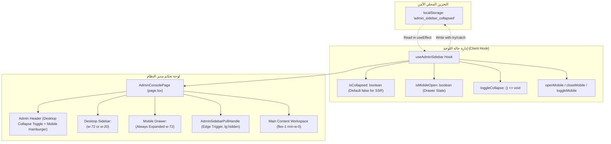

# تصميم لوحة تحكم مدير النظام المتجاوبة والقائمة الجانبية القابلة للطي والسحب (Responsive Admin Console & Collapsible Sidebar Design)

* **المؤلف (Author):** Ammar
* **الحالة (Status):** Approved
* **التاريخ (Date):** 2026-11-15
* **الهدف (Target):** `src/app/(admin)/admin/page.tsx`, `src/features/admin/components/AdminSidebar.tsx`, `src/features/admin/*`

---

## 1. المشكلة وسياق العمل (The Problem & Context)

تعرض لوحة تحكم مدير النظام الحالية (`/admin`) البيانات التشغيلية والمالية، إلا أنها تواجه قيوداً هندسية في التجاوب عبر أحجام الشاشات المختلفة:

1. **جمود القائمة الجانبية على الشاشات الكبيرة:**
   - القائمة الجانبية الحالية ثابتة بعرض `w-72` (288 بكسل)، مما يستهلك مساحة أفقية كبيرة على الشاشات المتوسطة (أجهزة الحاسوب المحمولة 13-14 بوصة بدقة 1366x768 أو 1280x800)، ويضيق المساحة المتاحة للجداول المالية الكبيرة وجداول المستخدمين والتحليلات.
   - عدم وجود خيار لتصغير القائمة الجانبية إلى **نمط الأيقونات المصغر (Icons-Only Rail Mode)** لتوفير مساحة أفقية وتوسيع مساحة العمل الرئيسية.

2. **صعوبة الوصول إلى القائمة على شاشات الجوال والأجهزة اللوحية:**
   - على شاشات الهواتف والأجهزة اللوحية (< 1024 بكسل)، يتم إخفاء القائمة بالكامل وراء زر Hamburger وحيد في أعلى الزاوية اليسرى من الترويسة، مما يصعب الوصول إليه بيد واحدة على الهواتف الحديثة ذات الشاشات الطويلة.
   - غياب **مقبض السحب الجانبي (AdminSidebarPullHandle)** على الحافة اليمنى للشاشة (RTL)، وغياب دعم حركات السحب باللمس (Swipe Gestures).

3. **التكيف مع الشاشات المتعددة (Foldables, Tablets, Ultra-wide):**
   - الجداول المعقدة (المستخدمين، البلاغات، الفواتير المالية، الحصص، أسعار العملات) تحتاج إلى معالجة مرنة عبر حاويات تمرير أفقي صريحة (`overflow-x-auto min-w-[640px]`) على الشاشات الصغيرة لمنع كسر التنسيق أو الانزياح الأفقي غير المقصود (Horizontal Overflow).

---

## 2. الأهداف ونطاق العمل (Goals & Non-Goals)

### الأهداف (Goals)
1. **القائمة الجانبية ثنائية النمط للشاشات المتوسطة والكبيرة (Desktop / Laptop >= 1024px):**
   - **النمط الكامل الممتد (Expanded Mode - `w-72`):** يعرض الشعار والاسم وعناوين التبويبات والشارات الرقمية وروابط التنقل السريع.
   - **نمط الأيقونات المصغر (Icons-Only Rail Mode - `w-20`):** يعرض أيقونات التبويبات المتمركزة أفقياً (`justify-center`)، مع شارات رقمية مصغرة فوق الأيقونة (`absolute -top-1 -right-1 text-[9px] min-w-4 h-4 rounded-full`)، وتلميحات توضيحية (Tooltips عبر `title` و `aria-label`) عند تمرير الفأرة (Hover)، مما يوفر مساحة أفقية (أكثر من 200 بكسل) لمساحة العمل.
   - زر تحكم (Toggle Button) في الترويسة وأعلى القائمة للتبديل بين النمطين، مع حفظ تفضيل المدير في `localStorage` (`admin_sidebar_collapsed`).
2. **مقبض السحب الجانبي وحركات اللمس للشاشات الصغيرة والأجهزة اللوحية (< 1024px):**
   - **مقبض السحب الجانبي (`AdminSidebarPullHandle`):** مثبت على الحافة اليمنى للشاشة (`fixed right-0 top-1/2 -translate-y-1/2 z-40 lg:hidden`) بمساحة لمس مخصصة للاستخدام بيد واحدة لسحب القائمة وفتح **الدرج المنبثق (`Slide-over Drawer`)**.
   - دعم إيماءات اللمس (Swipe Gestures) المحددة بمحور الحركة الأفقي لفتح القائمة وإغلاقها.
   - **عزل الدرج المنبثق عن الطي:** يظل الدرج المنبثق على الموبايل والتابلت دائماً في النمط الكامل الممتد (`Expanded`) بأسماء التبويبات وزر الإغلاق `X` حتى لو كانت القائمة المكتبية في وضع الطي.
3. **تجاوب كامل للوحة التحكم عبر جميع التبويبات:**
   - دعم الشاشات الصغيرة (320px)، الهواتف العادية (375px - 430px)، الأجهزة القابلة للطي والأجهزة اللوحية (640px - 1023px)، والحواسيب المكتبية والشاشات العريضة (1440px+).
   - احتواء الجداول والمصفوفات المالية وبطاقات المؤشرات (Stat Cards) داخل حاويات تمرير أفقي مرنة تمنع تشوه عناصر الصفحة.
4. **الحفاظ على التوافق التام (Backward Compatibility) وأمان الـ SSR:**
   - الحفاظ على واجهات البرمجة والأنواع الحالية لـ `AdminSidebarProps` عبر جعل الخصائص الجديدة اختيارية (`isCollapsed?: boolean` بقيمة افتراضية `false`، و `onToggleCollapse?: () => void`).
   - خلو كامل من أخطاء الهايدريشن (Hydration Mismatch) عبر بدء الرندر المبدئي دائماً بنمط `isCollapsed = false` المطابق للـ SSR، وتأجيل قراءة `localStorage` إلى `useEffect` بعد اكتمال الـ Mount.
   - بقاء كافة الاختبارات الحالية خضراء بنسبة 100%.

### غير الأهداف (Non-Goals)
- تغيير بنية صلاحيات المشرفين (RBAC) أو واجهات الـ API الخلفية.
- تغيير المنطق التجاري الداخلي لعمليات الدفع أو إدارة المستخدمين.

---

## 3. الخطة التقنية والمعمارية (Technical Architecture)

### 3.1 معمارية الحالة والمكونات (State Architecture)



### 3.2 مصفوفة نقاط التوقف وسلوك القائمة (Responsive Breakpoints Matrix)

| فئة الشاشة | العرض (Width) | سلوك القائمة الجانبية (Sidebar) | عناصر التحكم والتفاعل |
|---|---|---|---|
| **هواتف صغيرة (Mobile XS/SM)** | `320px - 639px` | مخفية افتراضياً، تنبثق كدرج منبثق (`Slide-over Drawer`) كامل الارتفاع بنمط ممتد دائماً | مقبض السحب الجانبي (`AdminSidebarPullHandle`) + زر Hamburger بالترويسة + إيماءات اللمس المقيدة |
| **أجهزة لوحية (Tablet MD)** | `640px - 1023px` | مخفية افتراضياً، تنبثق كدرج منبثق (`Slide-over Drawer`) بنمط ممتد دائماً | مقبض السحب الجانبي + زر الترويسة |
| **حواسيب محمولة ومكتبية (Desktop LG/XL)** | `1024px - 1439px` | شريط جانبي ثابت قابل للتبديل بين النمط الممتد (`w-72`) ونمط الأيقونات المصغر (`w-20`) | زر التبديل (Toggle Button) في الترويسة وأعلى القائمة مع حفظ التفضيل محلياً |
| **شاشات فائقة العرض (Ultra-wide 2XL+)** | `1440px+` | شريط جانبي ثابت قابل للتبديل، ومساحة عمل محددة العرض بـ `max-w-7xl` تتمدد بسلاسة | زر التبديل السريع للقائمة |

### 3.3 مقبض السحب الجانبي (AdminSidebarPullHandle)
- مثبت على الحافة اليمنى للشاشة:
  `className="fixed right-0 top-1/2 -translate-y-1/2 z-40 lg:hidden flex items-center justify-center w-6 h-14 bg-primary text-on-primary rounded-l-xl shadow-lg border-l border-y border-outline-variant/30 cursor-pointer select-none transition-transform active:scale-95"`
- يتم إخفاء المقبض تلقائياً عند كون الدرج مفتوحاً (`isOpenMobile === true`) لتفادي تداخل العناصر المرئية مع طبقة التعتيم (Backdrop).
- يحمل صفات الوصولية: `aria-label="فتح القائمة الجانبية"` و `role="button"`.
- إيماءات اللمس (Touch Gestures):
  - يتم الاستماع لأحداث `onTouchStart` و `onTouchEnd` الأصلية فقط على عنصر المقبض.
  - حساب الفرق التفاضلي:
    ```typescript
    const deltaX = touchEndX - touchStartX;
    const deltaY = touchEndY - touchStartY;
    if (Math.abs(deltaY) > Math.abs(deltaX)) return; // تجاهل التمرير الرأسي
    if (deltaX < -30) onOpen(); // سحب من اليمين إلى اليسار في RTL يفتح الدرج
    ```

### 3.4 تفاصيل نمط الأيقونات المصغر (Icons-Only Rail Mode)
- ينحصر تأثير `isCollapsed` على شريط العرض المكتبي `<aside className="hidden lg:block ...">`.
- التحولات البصرية عند `isCollapsed = true`:
  - يتغير عرض الحاوية من `w-72` إلى `w-20` مع فئة الانتقال (`transition-all duration-300`).
  - **ترويسة الشعار:** يتم إخفاء النصوص (`روابط | AN LINKS` و `Console المشغّل والمدير`) ويظل أيقونة الدرع (`Shield`) في المنتصف.
  - **عناوين الفئات:** يتم إخفاء عنوان `إدارة النظام` و `التنقل السريع` واستبدالهما بفاصل أفقي دقيق (`<div className="my-2 border-t border-outline-variant/15" />`).
  - **أزرار التبويبات:** تتحول من `justify-between px-3.5` إلى `justify-center px-0 w-12 h-12 mx-auto relative`، وتُخفى نصوص التبويبات، مع بقاء الخاصية `title={item.label}` و `aria-label={item.label}` لإتاحة التلميحات الفورية.
  - **الشارات الرقمية:** تتحول من شكل الكبسولة إلى شارة دائرية مصغرة فوق زاوية الأيقونة:
    `className="absolute -top-1 -right-1 min-w-4 h-4 px-1 rounded-full text-[9px] font-mono font-bold flex items-center justify-center bg-primary text-on-primary"`
  - **أزرار التذييل:** تظهر أيقونات الروابط فقط متمركزة مع `title` وصفي.
  - **زر الطي الجانبي:** يتضمن أيقونة `ChevronRight` عندما تكون القائمة ممتدة (للطي باتجاه حافة الشاشة اليمنى في RTL)، وأيقونة `ChevronLeft` عندما تكون مطوية (لإعادة التوسيع نحو مساحة المحتوى).

---

## 4. البدائل المدروسة (Alternatives Considered)

1. **القائمة السفلية (Bottom Navigation Bar) للموبايل:**
   - *الرفض:* لوحة التحكم تتضمن 6 أقسام رئيسية و 6 تبويبات فرعية، ولا يمكن حصر هذا الكم المعقد في شريط سفلي يتسع لـ 4-5 أيقونات فقط؛ لذا فإن الدرج الجانبي المنبثق هو المعيار المعتمد في الأنظمة الإدارية المؤسسية.
2. **التوسيع التلقائي عند تمرير الفأرة (Hover-to-Expand):**
   - *الرفض:* يتسبب في قفزات مفاجئة للواجهة (Layout Jitter) وإزاحة المحتوى بمجرد تحريك الفأرة بالخطأ، ولا يعمل نهائياً على شاشات اللمس؛ لذلك تم اعتماد التبديل الحتمي الصريح عبر النقر (Explicit Click Toggle).
3. **تطبيق صفحات منفصلة للموبايل:**
   - *الرفض:* يزيد من تشتت الكود وتكراره، بينما التجاوب المعتمد على Tailwind CSS سهولة صيانة عبر الحفاظ على قاعدة كود وشجرة مكونات موحدة دون ازدواجية الصفحات.

---

## 5. خطة التنفيذ التفصيلية (Detailed Implementation Plan)

### Task 1: خطاف إدارة حالة القائمة الجانبية (`useAdminSidebar.ts`)
- **الملف:** `src/features/admin/hooks/useAdminSidebar.ts` [إنشاء]
- **الهدف:** إدارة حالتي الطي المكتبي والدرج المنبثق للموبايل بأمان تام مع SSR و React 19.
- **العقد البرمجي:**
  ```typescript
  export interface UseAdminSidebarReturn {
    isCollapsed: boolean;
    isMobileOpen: boolean;
    toggleCollapse: () => void;
    openMobile: () => void;
    closeMobile: () => void;
    toggleMobile: () => void;
  }
  ```
- **آلية العمل:**
  - البدء دائماً بـ `isCollapsed = false` و `isMobileOpen = false`.
  - قراءة `localStorage.getItem("admin_sidebar_collapsed")` داخل `useEffect` بعد اكتمال الـ Mount لتفادي أخطاء الهايدريشن.
  - حفظ التغييرات في `localStorage` مع كتلة `try/catch`.
  - تنظيف مستمع أحداث النوافذ (`window.removeEventListener`) بشكل كامل.

---

### Task 2: مقبض السحب الجانبي للموبايل (`AdminSidebarPullHandle.tsx`)
- **الملف:** `src/features/admin/components/AdminSidebarPullHandle.tsx` [إنشاء]
- **الهدف:** توفير زر سحب مخصص ومثبت على الحافة اليمنى للشاشة مع دعم اللمس.
- **الخصائص (Props):**
  ```typescript
  export interface AdminSidebarPullHandleProps {
    isOpen: boolean;
    onOpen: () => void;
  }
  ```
- **آلية العمل:**
  - يظهر فقط على الشاشات الأصغر من 1024px (`lg:hidden`).
  - يختفي عند كون القائمة مفتوحة (`if (isOpen) return null`).
  - يدعم النقر المباشر وإيماءة السحب الأفقي باللمس.

---

### Task 3: ترقية القائمة الجانبية لدعم نمط الأيقونات المصغر (`AdminSidebar.tsx`)
- **الملف:** `src/features/admin/components/AdminSidebar.tsx` [تعديل]
- **الهدف:** دعم النمطين الممتد والمصغر دون التأثير على درج الموبايل.
- **ترقية واجهة الخصائص:**
  ```typescript
  export interface AdminSidebarProps {
    activeTab: AdminTabKey;
    onTabChange: (tab: AdminTabKey) => void;
    usersCount?: number;
    sessionsCount?: number;
    pendingReportsCount?: number;
    isOpenMobile?: boolean;
    onCloseMobile?: () => void;
    isCollapsed?: boolean;
    onToggleCollapse?: () => void;
  }
  ```
- **التنفيذ:**
  - تقسيم رندر المحتوى: دالة مساعدة تأخذ `isCollapsedView: boolean`، بحيث يُمرر لها `isCollapsed` في العرض المكتبي (`<aside>`) ويُمرر لها دائماً `false` في عرض الدرج المنبثق للموبايل.
  - إضافة زر الطي (`onToggleCollapse`) في ترويسة الشريط المكتبي.
  - تحويل الأزرار والشارات الرقمية تلقائياً في نمط الأيقونات المصغر.

---

### Task 4: دمج التجاوب والترويسة في صفحة الإدارة الرئيسية (`page.tsx`)
- **الملف:** `src/app/(admin)/admin/page.tsx` [تعديل]
- **الهدف:** ربط `useAdminSidebar` وتضمين مقبض السحب وزر التبديل في الترويسة.
- **التنفيذ:**
  - استبدال إدارة الحالة المحلية لـ `isMobileMenuOpen` بخطاف `useAdminSidebar`.
  - تركيب `AdminSidebarPullHandle` على مستوى الصفحة.
  - تمرير `isCollapsed` و `onToggleCollapse` إلى `AdminSidebar`.
  - إضافة زر طي/توسيع القائمة المكتبي بجانب شارة المسار في الترويسة العلوية (`hidden lg:flex`).

---

### Task 5: تدقيق التمرير الأفقي الآمن لجداول البيانات المالية والمستخدمين
- **الملفات المستهدفة:**
  - `src/features/admin/components/AdminUsersTable.tsx`
  - `src/features/admin/components/AdminReportsTable.tsx`
  - `src/features/admin/components/payments/tabs/GatewaysSubTab.tsx`
  - `src/features/admin/components/payments/tabs/CurrenciesSubTab.tsx`
- **التنفيذ:**
  - التحقق من وجود `overflow-x-auto` و `min-w-[640px]` على عناصر الجداول لضمان عدم انزياح شاشة الموبايل عند تصفح الجداول الغنية بالأعمدة.

---

### Task 6: تصدير المكونات والخطافات في واجهة الحزمة (`src/features/admin/index.ts`)
- **الملف:** `src/features/admin/index.ts` [تعديل]
- **التنفيذ:**
  - تصدير `useAdminSidebar` و `AdminSidebarPullHandle` وواجهات الخصائص المرافقة.

---

### Task 7: اختبارات الوحدة والتكامل والتأكيد النهائي
- **الملفات:**
  - `tests/unit/admin-sidebar-responsive.test.tsx` [إنشاء]:
    - اختبار تصيير `AdminSidebar` بنمط ممتد (`w-72`) ونمط مصغر (`w-20`).
    - اختبار احتفاظ درج الموبايل بكامل عناصره ونصوصه حتى عند تمرير `isCollapsed: true`.
    - اختبار تصيير الشارات المصغرة وزر الطي.
  - `tests/integration/admin-sidebar-layout.test.ts` [تحديث]:
    - تأكيد استمرار اجتياز كافة اختبارات التكامل الأربعة الحالية.
- **أوامر التحقق الإلزامية:**
  1. `npx vitest run tests/unit/admin-sidebar-responsive.test.tsx`
  2. `npx vitest run tests/integration/admin-sidebar-layout.test.ts`
  3. `npx tsc --noEmit`
  4. `npm run test` (كافة الـ 40 ملف اختبار تجتاز بنسبة 100%)
  5. `npm run build` (Next.js 15 الإنتاجي ينتهي بنجاح تام)
